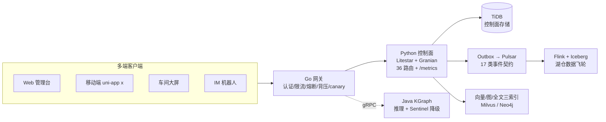
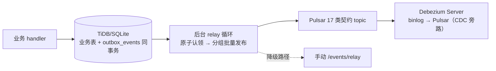
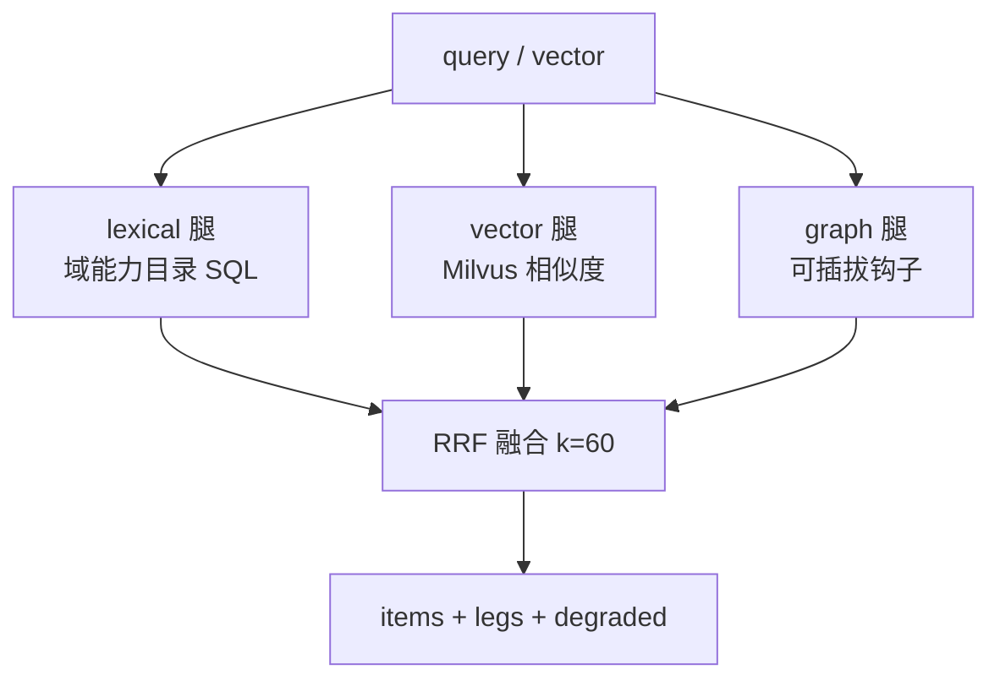

# Yadea Technology Group AI Knowledge Base Platform (EKB)

> 技术栈（2026-09）：**Litestar 2.24（全异步 ASGI）+ Granian（Rust HTTP 服务器）+ Pydantic v2 + TiDB/Pulsar/Redis/Neo4j/Milvus + K8s/Helm/Kustomize + Go/Java 多语言服务**

## 0. 项目速览（数字化看板）

| 维度 | 数字 | 说明 |
|---|---|---|
| 测试 | **79 Python + 11 Java + 3 前端组件** | 全栈测试矩阵 |
| 工程门禁 | **4 道** | 契约一致性 / Flink preflight / replay SLO / gateway SLO |
| API 路由 | **37 个 / 11 上下文模块** | `api/` 包限界上下文组织，契约 1:1 对齐（含 /retrieval/hybrid） |
| 事件契约 | **17 类** | Pulsar topic 契约化管理 |
| 可观测 | `/metrics` Prometheus | HTTP 时延 summary + Outbox 状态 gauge |
| 风控 | 签名防重放 + JWT + 分布式限流 | `EKB_REQUEST_SIGNING_SECRET` / `EKB_JWT_HS256_SECRET` / `EKB_RATE_LIMIT_BACKEND` |
| 架构评审 | **7.2 / 10** | 见 `docs/architecture-review-2026-09.md`（P0/P1/P2 路线图） |
| 并发目标 | 100万+ 连接 | 当前为高吞吐就绪基线，达标路径见评审 §4 P0 |
| 部署资产 | 5 形态 + CDC | K8s / Helm / Kustomize / Compose / 裸机一键 + Debezium CDC |
| 前端 | M1 管理台 | `web/admin/`（React18+Vite+TS，设计令牌单源，gzip 47.6KB） |

### 系统架构一图



### 质量门禁流水线（一键脚本内建）

```text
工具链自检 → 契约一致性(37路由/17事件/14字段) → Flink preflight → replay e2e SLO → gateway SLO → 构建/部署
```

### 架构深化：缓存 / 事件 / 检索三条主链路

**① 多级缓存与失效链**（读路径命中即省一次源库往返；命中率指标实时可查）

```mermaid
flowchart LR
    REQ[读请求] --> L1[L1 进程内 TTL+LRU 60s]
    L1 -- miss --> L2[L2 Redis 300s]
    L2 -- miss --> SRC[源: TiDB / Milvus]
    L1 & L2 & SRC --> M[/ekb_cache_hits_total{layer}/]
    W[写: 能力upsert / Skill晋级 / 向量upsert] -- 前缀失效 or registry epoch --> INV[失效通道] --> L1
```

**② 事件主链**（写路径零阻塞发布，多副本原子认领）



**③ 混合检索链**（对齐行业实证：hybrid NDCG +26-31%）



**④ GraphQL 决策**：治理面维持 REST+契约门禁（解析开销 5-15%、契约体系重建成本 vs 收益，详见评审 §12/§17.5）；性能提升由缓存/后台 relay/混合检索承担。P2 触发条件：M2 移动端出现 ≥3 路 round-trip 聚合场景时，以只读 GraphQL BFF（persisted queries）引入。

### 效能与质量量化（四轮演进）

| 指标 | v1（评审前） | v3（当前） | 演进 |
|---|---|---|---|
| Python 测试 | 57 | **79** | +22（风控 6 / 缓存 4 / relay 2 / 检索 5 / 迁移加固 5） |
| Java 测试 | 4 类 | **11 通过** | 去 mock 后全绿 |
| 前端测试 | 0 | **3 组件测试** | vitest + RTL |
| app.py 体量 | 1434 行单体 | **75 行装配** | 10 上下文模块化 |
| 工程门禁 | 4 道（两道曾误报） | 4 道全绿 + 扩展 api/ 扫描 | 脆弱解析加固 |
| 综合评分 | 6.1 | **7.2** | 6.1→6.5→6.9→7.0→7.2 |

本项目基于以下两份顶层架构文档落地实现：

- `docs/sources/industrial-ai-kb-fullstack-architecture.zh-CN.md`
- `docs/sources/ai-knowledge-management-4r-v5-architecture.zh-CN.md`
- 需求调研输入：`docs/sources/yadea-ai-kb-requirements-research-report.zh-CN.pdf`

目标：支撑雅迪科技集团（全国多分公司 + 全球多生产基地）企业级垂类 AI 知识库，面向 **100万+ 并发访问** 的可上线工程基线。

## 1. 项目交付内容

- 雅迪科技集团企业级上线蓝图（架构、治理、SRE、DR、合规）
- MCP 控制面与网关基线服务（Litestar + Granian 全异步栈）
- Agent Skills 注册与治理能力
- Harness（质量/安全/回归）评测框架
- 容量规划与并发估算模型
- Kubernetes 多区域部署基线（含 HPA、PDB、NetworkPolicy）

## 2. 目录结构

```text
docs/
  sources/
    industrial-ai-kb-fullstack-architecture.zh-CN.md
    ai-knowledge-management-4r-v5-architecture.zh-CN.md
    yadea-ai-kb-requirements-research-report.zh-CN.pdf
  master-navigation.md
  storage/
    README.md
    sql-ddl-spec.md
    cache-keys.md
    vector-schema.md
    graph-schema.md
    implementation-mappings.md
  enterprise-delivery-blueprint.md
  mcp-agent-skills-harness-governance.md
  global-deployment-and-dr.md
  phase2-eventing-and-sre.md
  phase3-hardening-architecture.md
  requirements-traceability.md
  public-release-pack.md
  architecture/
    README.md
    technical-architecture.md
    data-architecture.md
    deployment-architecture.md
    runtime-architecture.md
    implementation-process.md
    interaction-sequence-diagrams.md
    foundations-and-skill-primer.md
    industrial-scale-roadmap.md

infra/
  k8s/base/
    namespace.yaml
    configmap.yaml
    deployment-ekb-control-plane.yaml
    service.yaml
    hpa.yaml
    pdb.yaml
    networkpolicy.yaml
  helm/ekb-control-plane/
    Chart.yaml
    values.yaml
    templates/*.yaml
  kustomize/
    base/kustomization.yaml
    overlays/staging/kustomization.yaml
    overlays/production/kustomization.yaml
  docker-compose.phase3.yml
  baremetal/
    install.sh
    README.md

perf/
  k6/
    load-test.js
    README.md

src/enterprise_ekb/
  app.py
  schemas.py
  policy.py
  skill_registry.py
  mcp_gateway.py
  harness.py
  capacity.py
  storage.py
  event_bus.py
  config.py
  tidb_store.py

services/
  java-kgraph/
  go-gateway/

contracts/
  openapi/control-plane.openapi.yaml
  proto/ekb_contracts.proto
  pulsar-topics.yaml
  a2a-protocol.yaml

tests/
  test_skill_registry.py
  test_policy_and_gateway.py
  test_harness.py
  test_capacity.py
  test_storage_and_outbox.py
  test_app_phase2.py
```

## 3. 快速启动

### 3.1 环境准备

```bash
python3 -m venv .venv
source .venv/bin/activate
pip install -e .[dev]
bash scripts/bootstrap_dev_toolchain.sh
python3 scripts/check_dev_toolchain.py
```

### 3.2 运行 API

```bash
granian --interface asgi --reload enterprise_ekb.app:app --port 8080
```

### 3.3 运行测试

```bash
pytest -q
```

### 3.4 空白机器一键构建与部署

```bash
# 本地容器化一键模式（Colima + 国内镜像源）
colima start
docker context use colima
bash scripts/colima_registry_setup.sh
bash scripts/one_click_build_and_deploy.sh local

# Kubernetes一键模式（需要kubectl/helm可用）
# 需要先导出对象存储凭据（用于Flink/Iceberg preflight）
export AWS_ACCESS_KEY_ID="<your-access-key>"
export AWS_SECRET_ACCESS_KEY="<your-secret-key>"
bash scripts/colima_registry_setup.sh
bash scripts/one_click_build_and_deploy.sh k8s
```

该脚本会自动执行：
- 开发工具链安装与检测
- 契约一致性门禁
- Flink 运行时依赖 preflight 合约门禁
- replay e2e SLO 门禁
- 然后再进行 local/k8s 部署

空白机器标准说明：
- 脚本会先执行 `scripts/bootstrap_deploy_runtime.sh` 自动安装运行时依赖（brew 或 apt-get）
- 再执行 `scripts/bootstrap_dev_toolchain.sh` 自动安装开发门禁依赖
- CI 中的 smoke 工作流通过 `SKIP_BOOTSTRAP_*` 跳过重复安装，仅验证一键流程可执行性

跨平台脚本：
- macOS/Linux 通用：`scripts/one_click_build_and_deploy.sh`
- Windows 11 PowerShell：`scripts/one_click_build_and_deploy.ps1`
- Linux 运行时单独引导：`scripts/bootstrap_deploy_runtime_linux.sh`
- Windows 运行时单独引导：`scripts/bootstrap_deploy_runtime.ps1`

一键全关停（本地服务/中间件/基础设施）：

```bash
bash scripts/one_click_shutdown_all.sh
```

K8S 模式会先部署依赖中间件（Pulsar/TiDB/Redis/Neo4j/Milvus）并执行 `scripts/verify_k8s_stack.py` 校验。

## 4. 核心接口

- `GET /healthz`：健康检查
- `GET /readyz`：就绪与Outbox状态
- `GET /metrics`：Prometheus 文本格式指标（HTTP 时延 summary、Outbox 状态 gauge）
- `POST /skills/register`：注册 Skill
- `POST /skills/promote`：Skill 版本晋级
- `POST /mcp/invoke`：MCP 网关调用（含租户策略校验）
- `POST /harness/evaluate`：Harness 评测（质量/安全/回归）
- `POST /capacity/estimate`：并发与资源估算
- `POST /audit/query`：审计查询
- `POST /events/relay`：Outbox事件发布
- `POST /a2a/publish`：A2A消息发布
- `POST /a2a/consume`：A2A消息消费（单次）
- `POST /graph/upsert`：图关系写入
- `POST /vector/upsert`：向量写入
- `POST /vector/search`：向量检索
- `POST /domain/capabilities/upsert`：业务域能力登记/更新
- `POST /domain/capabilities/search`：业务域能力检索
- `GET /domain/capabilities/coverage`：业务域能力覆盖率审计
- `POST /domain/capabilities/bootstrap`：按雅迪需求基线初始化能力项
- `POST /connectors/ingest`：ERP/MES/SCADA/工单连接器统一事件接入
- `POST /connectors/replay`：连接器事件回放（支持按系统过滤）
- `POST /connectors/profiles/upsert`：连接器联调配置（认证/地址/批次）登记
- `POST /connectors/profiles/list`：连接器配置查询
- `POST /connectors/checkpoint/get`：游标检查点读取
- `POST /connectors/checkpoint/update`：游标检查点更新
- `POST /connectors/health`：联调健康检查（配置可用性）
- `POST /connectors/pull`：联调拉取（dry_run / commit）
- `POST /retrieval/hybrid`：混合检索（lexical+vector+graph，RRF 融合，降级不失败）

连接器接入默认具备幂等语义：`(connector_system, idempotency_key)` 唯一约束，重复提交返回 `replayed` 并记录 replay 计数。

联调适配层说明：
- `adapter_type` 支持在 profile 中声明（默认 `generic`），便于切换 SAP/ServiceNow 等具体适配器。

发布部署安全处理：
- `python scripts/release_protect_artifacts.py --mode verify`：发布前校验代码摘要
- `python scripts/release_protect_artifacts.py --mode protect --obfuscation-level 2`：生成保护产物与 manifest
- 可通过 `EKB_RELEASE_PROTECT_KEY` 注入发布密钥

## 4.1 三期多语言服务

- Java KGraph Service: `services/java-kgraph`
- Go Gateway Service: `services/go-gateway`

## 5. 生产落地建议

1. 控制面多活（总部双中心 + 区域集群）
2. 数据分级（Global / Regional / Local）与“数据不出厂”策略
3. MCP Registry + Policy Engine + 审计追踪强绑定
4. Harness 作为上线门禁（质量、安全、回归三门）
5. SLO 驱动容量与成本优化（首 Token、P99、错误率、降级率）
6. 生产数据库主选型使用 TiDB，开发测试允许 SQLite 回退

## 6. Phase-3-3 环境变量（显式清单 + 生产默认）

> 说明：以下默认值分为“代码默认（开发回退）”与“生产建议默认（部署时应覆盖）”。

### 6.1 控制面（Python / `src/enterprise_ekb/config.py`）

| 环境变量 | 代码默认 | 生产建议默认 | 用途 |
|---|---|---|---|
| `EKB_DB_DRIVER` | `sqlite` | `tidb` | 控制面关系库驱动 |
| `EKB_DB_PATH` | `./data/control_plane.db` | `/var/lib/ekb/control_plane.db`（仅回退） | SQLite 回退路径 |
| `EKB_TIDB_HOST` | `127.0.0.1` | `tidb-cluster-tidb` | TiDB 地址 |
| `EKB_TIDB_PORT` | `4000` | `4000` | TiDB 端口 |
| `EKB_TIDB_USER` | `root` | `ekb_app`（建议最小权限账号） | TiDB 用户 |
| `EKB_TIDB_PASSWORD` | `` | `<from-secret>` | TiDB 密码 |
| `EKB_TIDB_DATABASE` | `ekb_control_plane` | `ekb_control_plane` | TiDB 库名 |
| `EKB_EVENT_PUBLISHER_BACKEND` | `memory` | `pulsar` | 事件发布后端 |
| `EKB_PULSAR_SERVICE_URL` | `pulsar://127.0.0.1:6650` | `pulsar://pulsar-broker:6650`（或TLS地址） | Pulsar 连接 |
| `EKB_PULSAR_TOKEN` | `` | `<from-secret>` | Pulsar 鉴权 Token |
| `EKB_PULSAR_TLS_ENABLED` | `false` | `true`（跨机房/公网建议） | Pulsar TLS 开关 |
| `EKB_PULSAR_CA_CERT_PATH` | `` | `/etc/ssl/certs/pulsar-ca.crt` | Pulsar CA 证书路径 |
| `EKB_REDIS_URL` | `redis://127.0.0.1:6379/0` | `redis://redis-cluster:6379/0` | Redis 连接 |
| `EKB_REDIS_MAX_CONNECTIONS` | `200` | `500`（按压测调优） | Redis 连接池上限 |
| `EKB_REDIS_SOCKET_TIMEOUT_SECONDS` | `0.2` | `0.2` | Redis 读超时 |
| `EKB_REDIS_SOCKET_CONNECT_TIMEOUT_SECONDS` | `0.2` | `0.2` | Redis 连接超时 |
| `EKB_NEO4J_URI` | `bolt://127.0.0.1:7687` | `bolt://neo4j:7687` | Neo4j 地址 |
| `EKB_NEO4J_USERNAME` | `neo4j` | `ekb_reader_writer` | Neo4j 用户 |
| `EKB_NEO4J_PASSWORD` | `neo4j` | `<from-secret>` | Neo4j 密码 |
| `EKB_NEO4J_MAX_CONNECTION_POOL_SIZE` | `100` | `200`（按查询并发调优） | Neo4j 连接池 |
| `EKB_MILVUS_URI` | `http://127.0.0.1:19530` | `http://milvus:19530` | Milvus 地址 |
| `EKB_MILVUS_TOKEN` | `` | `<from-secret>` | Milvus Token |
| `EKB_MILVUS_DB_NAME` | `default` | `ekb_prod` | Milvus DB 名 |
| `EKB_AUTH_TOKEN` | `` | `<from-secret>` | MCP/A2A 认证 Token |
| `EKB_MCP_RATE_LIMIT_PER_MINUTE` | `6000` | `6000` | MCP 速率限制 |
| `EKB_A2A_RATE_LIMIT_PER_MINUTE` | `12000` | `12000` | A2A 速率限制 |
| `EKB_RATE_LIMIT_BACKEND` | `memory` | `redis` | 分布式限流后端（Redis 滑窗，故障降级内存） |
| `EKB_REQUEST_SIGNING_SECRET` | `` | `<from-secret>` | HMAC 请求签名密钥（防重放，空=关闭） |
| `EKB_REPLAY_WINDOW_SECONDS` | `300` | `300` | 签名时间窗 |
| `EKB_JWT_HS256_SECRET` | `` | `<from-secret>` | JWT HS256 校验密钥（与静态 Token 并存） |
| `EKB_JWT_EXPECTED_AUDIENCE` | `` | `ekb-control-plane` | JWT 受众校验 |
| `EKB_LOG_FORMAT` | `text` | `json` | 结构化日志（含 request_id 贯穿） |

### 6.2 Go Gateway

| 环境变量 | 代码默认 | 用途 |
|---|---|---|
| `SERVICE_NAME` | `go-dialogue-authz-gateway` | 网关服务标识（日志/健康输出） |

## 7. 架构落地覆盖结论（当前仓库）

| 能力域 | 当前状态 | 结论 |
|---|---|---|
| TiDB 主选型 | `tidb_store.py` + migrations + config 已落地 | ✅ 已落地 |
| Pulsar 事件总线 | Outbox + Relay + Pulsar publisher 已落地 | ✅ 已落地 |
| Redis/Neo4j/Milvus 客户端 | 高性能 client wrapper 已实现 | ✅ 已落地（控制面集成为可接入基线） |
| K8s/Helm/Kustomize | 基线清单、Chart、overlay 齐全 | ✅ 已落地 |
| MCP/Skill/Harness 治理 | 策略、注册、评测门禁已落地 | ✅ 已落地 |
| 多语言服务分工 | Python/Go 可运行基线；Java 去 mock（degraded 显式降级） | ⚠️ 部分落地（治理规则仍硬编码） |
| 混合检索 | RRF 融合 + 三腿（lexical/vector/graph） | ✅ 已落地（契约 1:1） |
| 后台事件 relay | lifespan 异步循环 + 运行指标 | ✅ 已落地（默认关闭，生产开启） |
| 前端管理台 | web/admin M1.5（令牌/组件/暗色/测试） | ✅ M1 达成（M2 移动端待启动） |

## 7.1 架构评审与重构记录（2026-09）

权威评审与重构方向见 [`docs/architecture-review-2026-09.md`](docs/architecture-review-2026-09.md)（10 维度打分 6.1/10 + P0/P1/P2 重构路线 + 业界最佳实践对标）。本次已实施并全量回归（62 测试全绿 + 四道门禁通过）：

- `R1` K8s base 清单 readinessProbe 修正为 `/readyz`
- `R2` Bearer 认证收敛为 `secrets.compare_digest` 常量时比较 + 单点 helper（原 8 处内联重复），token 缺省放行时输出 warning
- `R3` `_dump_alert` 双定义合并
- `R4` 新增零依赖 Prometheus `/metrics`（HTTP 时延 + Outbox gauge），OpenAPI 契约同步
- `R5` Pulsar/Milvus/Neo4j 初始化静默降级补日志
- `R6` 两道 SLO 门禁阈值解析加固（容忍 p90/任意顺序）
- `R7` 新增 5 项测试（`tests/test_metrics_and_auth_hardening.py`）
- `R8` **框架迁移**：FastAPI → Litestar 2.24 + Granian（Rust 服务器），62/62 回归 + 四门禁 + 真机冒烟通过，契约零漂移（详见 CHANGELOG 与评审 §7）

P0 待办（详见评审报告 §4）：异步化热路径、Redis 分布式限流、Outbox 原子认领、OAuth2.1/JWT 认证升级、deps 凭据整改、可观测三件套（结构化日志/OTel trace/指标聚合栈）。

## 8. 开源公开分享与上线标准自检

当前仓库已具备：

- 可运行代码（Python 控制面 + Java/Go 服务）
- 多语言测试与CI基础
- 部署资产（K8s/Helm/Kustomize/Compose）
- 架构、治理、SRE、需求追踪文档

仍建议在正式对外发布前补齐：

1. 明确 `LICENSE`、`SECURITY.md`、`SUPPORT.md`、`CODEOWNERS`
2. 提供 `env.example`（按环境分 dev/staging/prod）
3. 增加端到端联调与故障演练报告样例
4. 在 Helm 中将敏感项（密码/Token）改为 Secret 引用而非明文 value
5. 完整补全 Java/Go 对真实中间件客户端的生产实现与压测数据

### 8.1 已补齐的公开发布基础文件

- `LICENSE`（Apache-2.0）
- `SECURITY.md`
- `SUPPORT.md`
- `CODEOWNERS`
- `env.dev.example`
- `env.staging.example`
- `env.prod.example`

### 8.2 Helm Secret 化（已实施）

- 新增 `infra/helm/ekb-control-plane/templates/secret.yaml`
- `EKB_TIDB_PASSWORD`、`EKB_PULSAR_TOKEN`、`EKB_NEO4J_PASSWORD`、`EKB_MILVUS_TOKEN` 已通过 `secretKeyRef` 注入
- `values.yaml` 增加 `secrets.*` 配置段，支持集中管理敏感变量

## 9. 说明

本仓库提供的是可运行的企业级“控制面 + 治理面”工程基线。完整生产系统可在此基础上扩展：

- 各地域推理集群（vLLM / Triton）
- 文档处理与知识流水线（Pulsar/Flink）
- 向量/全文/图谱三索引数据面
- 企业 IM / 工单 / ERP / MES / SCADA 集成

## 9.1 Outbox 适用边界与本仓库升级结论

- 事务型 Outbox 适用于**本地事务 + 异步可靠投递**场景，核心价值是业务写入与事件发布解耦、失败可重试、可审计。
- 仅“简单 pending 扫描”并不等于分布式高性能；在多实例下会出现并发竞争、重复处理、吞吐受限。
- 本仓库已升级为：
  - 事件 claim/processing 状态（`claimed_by` / `claimed_at`）
  - topic 级批量发布（减少网络往返）
  - 指数退避重试（`next_retry_at`）
  - processing 统计与可观测
  - 基于 `EKB_RELAY_INSTANCE_ID`（或 `HOSTNAME-pid`）的唯一 claim 实例标识，避免多实例 claim 冲突
  - `processing` 过期事件自动回收再认领，避免异常退出导致事件永久卡死
- 对于更高吞吐或跨库强一致场景，建议下一阶段采用 CDC Outbox（如 Debezium）进一步解耦数据库轮询压力。

## 10. 三期-2强化说明

- TiDB 迁移脚本与迁移执行器：`src/enterprise_ekb/migrations/` + `migrator.py`
- Pulsar 真实发布器：`src/enterprise_ekb/event_bus.py`
- 多语言契约：`contracts/openapi` 与 `contracts/proto`
- 多语言 CI：`.github/workflows/ci-multilang.yml`

## 11. 架构材料与知识体系索引

新增架构材料目录：`docs/architecture/`

- `docs/master-navigation.md`：总导航页（Mermaid Mindmap + 全量入口）

- `technical-architecture.md`：技术架构
- `data-architecture.md`：数据架构
- `deployment-architecture.md`：部署架构
- `runtime-architecture.md`：运行架构
- `implementation-process.md`：实施流程
- `interaction-sequence-diagrams.md`：交互时序图
- `foundations-and-skill-primer.md`：基础知识与技能点

## 14. 仓库目录与命名规范（标准化）

- 顶层仅保留工程入口目录：`src/`、`tests/`、`docs/`、`infra/`、`services/`、`contracts/`、`scripts/`、`perf/`
- 外部输入源文档统一归档到 `docs/sources/`，采用 ASCII + 语义化命名
- 生成物与本地缓存（`__pycache__/`、`*.pyc`、`target/`、`.DS_Store`、`*.egg-info`、`.pytest_cache`）统一通过 `.gitignore` 管控，不放入仓库资料主干

## 13. 存储层设计与实现资料索引

为确保数据库、缓存、消息队列、向量与图数据层“设计+实现+映射”齐备，新增：

- `docs/storage/sql-ddl-spec.md`：SQL DDL 规范
- `docs/storage/cache-keys.md`：缓存 Key/TTL/失效策略
- `contracts/pulsar-topics.yaml`：Pulsar Topic 契约
- `docs/storage/vector-schema.md`：向量数据 schema/index 规范
- `docs/storage/graph-schema.md`：图数据模型与 Cypher 规范
- `docs/storage/implementation-mappings.md`：设计到代码/测试映射矩阵

## 12. 外部贡献工作流

- `CONTRIBUTING.md`
- `.github/PULL_REQUEST_TEMPLATE.md`
- `.github/ISSUE_TEMPLATE/`
  architecture/a2a-architecture.md
  architecture/industrial-scale-roadmap.md
  api/developer-api-manual.md
  api/developer-api-manual.zh-CN.md
  api/developer-api-manual.en.md
  product/platform-product-guide.md
  product/platform-product-guide.zh-CN.md
  product/platform-product-guide.en.md

## 15.1 前端管理台（M1）

```bash
cd web/admin && npm install
VITE_API_BASE=http://127.0.0.1:8080 npm run dev    # 开发
npm run build                                       # 构建（产物 web/admin/dist）
```

四页：运行健康（readyz+Outbox+metrics）/ 容量估算 / Skill 一键注册三级晋级 / 审计查询。设计令牌 `tokens/tokens.json`（W3C DTCG）为多端唯一视觉源。M1.5：组件化（Card/StatusDot/JsonView）+ 暗色主题 + 组件测试（`npm test`，vitest+RTL 3 项）+ tsc strict 构建门禁（gzip 48KB < 200KB 预算）。

## 15. 远端仓库与同步机制

- 远端：`github.com/tianqiongenze/AI-EKB`（private），主分支 `main`
- 同步流程（每次改动后）：

```bash
git pull --rebase origin main   # 先同步远端
git add -A && git commit -m "feat|fix|docs: ..."   # 原子化提交
git push origin main            # 推送即触发 GitHub Actions（ci-multilang.yml）
```

- 本地大文件治理：压测原始产物（`perf/artifacts/`）、运行时数据库（`tmp/`、`data/`、`*.db`）、构建产物（`target/`、`dist/`、`node_modules/`）均已通过 `.gitignore` 排除，**入库的是报告与门禁结果而非原始日志**。
- 提交纪律：`git push` 前本地必须通过 `pytest -q` 与四道门禁（一键脚本内建）。
