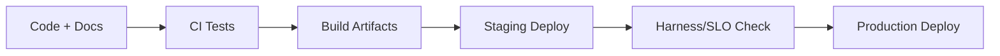

# Deployment Architecture

## 1. Deployment Topology

- Headquarters dual-center (active-active control plane)
- Regional clusters (domestic and overseas)
- Edge/factory nodes (local resilience capability)

## 2. Kubernetes Delivery Assets

### 2.1 Raw K8s baseline (`infra/k8s/base`)

- Namespace
- ConfigMap
- Deployment
- Service
- HPA
- PDB
- NetworkPolicy

### 2.2 Helm chart (`infra/helm/ekb-control-plane`)

- Parameterized image, scaling, resources, and env vars
- Secret template for sensitive values
- Deployment uses `secretKeyRef` for password/token injection

### 2.3 Kustomize overlays (`infra/kustomize/overlays/*`)

- Environment-specific overlays for staging and production

## 3. Secret Management Model

Sensitive config path:

- Helm values `secrets.*`
- Rendered Kubernetes Secret (`templates/secret.yaml`)
- Deployment `env.valueFrom.secretKeyRef`

Sensitive keys currently secret-backed:

- `EKB_TIDB_PASSWORD`
- `EKB_PULSAR_TOKEN`
- `EKB_NEO4J_PASSWORD`
- `EKB_MILVUS_TOKEN`

## 4. Multi-environment Config Strategy

- `env.dev.example`: local and fallback defaults
- `env.staging.example`: integration/staging profile
- `env.prod.example`: production baseline

## 5. Deployment Promotion Flow

