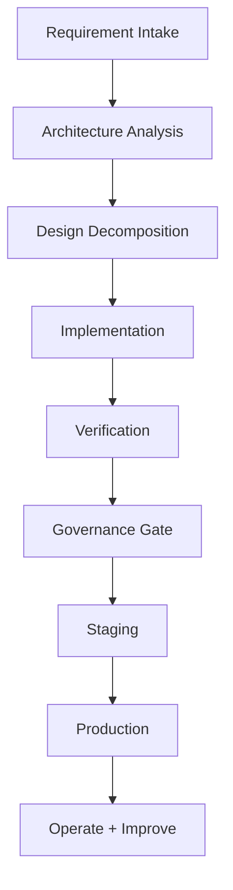
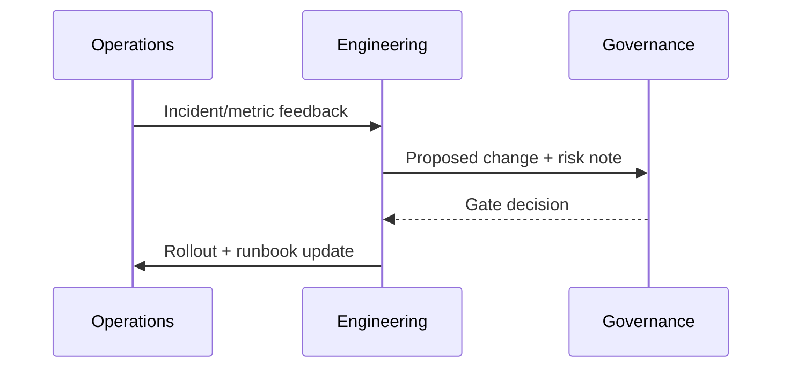

# Implementation Process

## 1. End-to-End Delivery Flow

## 2. Detailed Steps

1. Requirement intake
   - Consolidate architecture docs and requirement reports
2. Architecture decomposition
   - Define technical/data/deployment/runtime boundaries
3. Implementation
   - Python control plane
   - Java reasoning service
   - Go low-latency gateway
4. Verification
   - tests, diagnostics, build checks
5. Governance gate
   - Harness quality/safety/regression
6. Release
   - staged rollout and rollback preparedness
7. Operations
   - metrics, audits, runbooks, incident response

## 3. Change Management Rules

- Any architecture-affecting change must update corresponding docs
- Any sensitive configuration change must preserve secret injection model
- Any API/contract change must update OpenAPI/Proto and compatibility notes

## 4. Operational Feedback Loop

