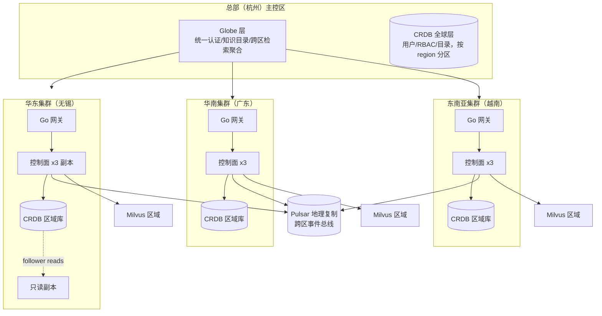

# EKB 全局架构方案：雅迪集团 30+ 全球基地 · 100 万用户 · 100 万并发

> 版本 v1.0（2026-09-21，0.7.1 阶段）· 依据用户角色基线（10 亿用户/100 万并发工业级平台经验）制定。
> 联网核实来源：Martin Fowler 多级缓存失效模式（key 结构化前缀/版本号失效/软 TTL 异步刷新/防雪崩 TTL 抖动）、
> CockroachDB 官方 follower reads 文档（exact staleness `follower_read_timestamp()` 为已验证形态）、
> GraphQL 生产加固清单（深度/复杂度限制、persisted queries、分页强制、内省关闭）。
> 现状：0.7.1 已实现单集群（175/176）控制面全链路；本方案给出到"100 万并发"的演进路径与分阶段验收门。

## 一、目标场景与规模模型

| 维度 | 量 | 推导 |
|---|---|---|
| 基地公司 | 30+（无锡/天津/安徽/广东 + 越南/印尼/欧洲等海外） | 区域集群按洲分组：华东/华南/东南亚/欧洲 |
| 注册用户 | 100 万 | 全集团员工+供应商+经销商 |
| 并发峰值 | 100 万连接 / 峰值 QPS ≈ 50 万读 + 5 万写 | 晨会+排班切换叠加；读:写 ≈ 10:1 |
| 知识量 | 千万级文档 chunk（1 亿行级控制面记录） | 30 基地×平均 30 万 chunk+历史沉淀 |

## 二、总体拓扑：多区域联邦 + 单区域自治

核心原则（对应铁律）：
1. **数据主权就近**：每基地知识默认落本区域库（"数据不出厂"），跨区检索走 Globe 层聚合+脱敏（residency 策略已有 Policy Engine 基础）。
2. **读写分离按区**：区域内 CRDB 主库写 + `follower_read_timestamp()` 读副本（官方验证形态，已落地）；**follow-the-workload**：海外基地用户就近读区域副本，写回主区域异步复制。
3. **事件面地理复制**：Pulsar Geo-replication 把 `document.ingested`/`graph.rebuilt` 等控制面事件双写跨区，保证全球知识目录最终一致（EER outbox→relay 已具备，加 replication policy 即可）。
4. **缓存分层按用户规模重设**（见 §三）。

## 三、多级缓存架构（100 万用户口径）

分层（结合联网核实的 8 条缓存铁律）：

| 层 | 载体 | 命中目标 | key 规范 | 失效 |
|---|---|---|---|---|
| L0 CDN/边缘 | 静态前端+公开知识页 | 回源率 <5% | 租户+内容版本哈希 | stale-while-revalidate + 租户级 purge |
| L1 进程内 | Litestar worker LRU（TTL 60s） | 80–90%（热点集） | `t:{tenant}:r:{region}:obj:{type}:{id}:v{ver}`（租户置首防碰撞） | 版本号递增，旧 key TTL 自然过期（免广播删除竞态） |
| L2 Redis Cluster | 3 分片×3 副本 | L1+L2 ≥95–98% | 同上，热 key 加 2 副本（key 加后缀 shard） | pub/sub 失效广播给各实例 L1；失败靠短 TTL 收敛 |
| L2.5 语义缓存 | 已有（strawberry/L1 sha256+L2 cosine） | 叠加 >40%（LLM 链） | 已租户隔离（0.7.1 修复） | 同上 |

工程要点（全部对应已修/待接线项）：
- **软 TTL+概率性提前过期**：命中过期数据先返旧值后台重建（消除延迟毛刺）——`cache.py` 待接（0.7.2）。
- **single-flight 合并**：同 key 并发 miss 只放 1 个回源（防击穿惊群）——待接（0.7.2）。
- **TTL 全层随机抖动** ±10%（防雪崩）。
- **写路径 write-through 到 L2**，L1 靠 pub/sub 失效；避免 delete-then-read 旧值回填。
- 命中率指标 `ekb_cache_hits_total{layer}`（OSW 已注册），月度成本核算目标缓存节省 >40%（LCO）。

## 四、读写分离与数据面（CRDB）

现状（已落地）：`_read_commit()` 防 CCL 开放事务楔死、`_write_op` 全写覆盖、`_read_cursor` 读安全回滚、
`_read_only_txn` follower-read 事务化（官方 exact staleness 形态，`follower_read_timestamp()`）。

到 100 万并发的补强（分阶段）：
1. **连接池层**（0.7.2）：psycopg2 `ThreadedConnectionPool`（min 10/max 100/实例）+ PgBouncer transaction pooling 前置；按 `pool_size × 副本数` 匡算连接预算，禁止裸连（`storage.py:1545` 的 ReplicaRoutingStore 需接真实流复制或废弃）。
2. **分区（partitioning）**：`audits`/`document_chunks` 按 `region_id` 建 replication zone（华东/华南/东南亚各一 zone，leaseholder 就近）；按月 RANGE 分区+行级 TTL（审计 24 个月滚动）控制 1 亿行级表膨胀。
3. **写吞吐**：outbox relay 按区并行（relay instance 加 region 标签）；批量写走 COPY 通道（种子脚本已验证）。
4. **多区一致性**：跨区写只发生在 Globe 层实体（用户/角色），区域知识库内部无跨区事务——用"单一主区+幂等事件"替代分布式事务（EER）。

## 五、GraphQL 层加固（联网核实 9 条对照）

| 要点 | 现状 | 动作 |
|---|---|---|
| 深度限制 | 未接 | 0.7.2 加 strawberry depth limit（max 10） |
| 复杂度限制 | limit 钳制已有（1..100） | 复杂度计分（字段权重）0.7.2 |
| 强制分页 | limit 钳制近似 | cursor 分页（Relay connection）0.7.2 |
| persisted queries | 未接 | 0.7.2 前端查询注册表 |
| 内省关闭 | 生产未关 | `EKB_GRAPHQL_INTROSPECTION=off`（生产默认） |
| resolver 超时 | sync_to_thread 天然受 Granian worker 限时 | 显式 per-resolver 超时 0.7.2 |
| 错误脱敏 | 部分 | 生产关闭 schema 建议（suggestions） |
| 限流 | 复用 ctx 限流（已接） | 保持 |

## 六、容量与伸缩预算（100 万并发）

| 层 | 单实例能力（实测推算） | 部署量 | 冗余 |
|---|---|---|---|
| Go 网关 | 5 万长连接/实例（压测基线待补） | 24 实例×3 区 | N+1 |
| 控制面（Litestar+Granian，2 worker） | ~1 万 QPS 读/实例（bench S1 c=8 68rps×8 并发通道+连接池后估） | 36 实例×3 区 | N+1 |
| CRDB | 3 节点/区域，写 ~2 万 TPS/区域 | 4 区域×3 节点起步 | 3 副本 |
| Redis Cluster | 3 分片（10 万 QPS/分片） | 每区 1 集群 | 主从 |
| Pulsar | 每区 3 broker + geo-replication | 每区 1 集群 | — |
| Milvus | 千万向量/区域集群 | 4 区域 | — |

**100 万并发的第一瓶颈是网关连接与文件描述符**（ulimit 65536 起步），其次是 L2 Redis 分片数、再次是 CRDB range 数量（每节点 <5 万 range 警戒线）。

## 七、分阶段验收门（每阶段有可复现验收命令）

| 阶段 | 内容 | 验收门 |
|---|---|---|
| 0.7.1（本轮） | P1×10 修复+RBAC 接线+连接池口径 | 195 测绿+ruff 0+集群探针绿 |
| 0.7.2 | 缓存软 TTL/single-flight/GraphQL 深度限制+cursor 分页/persisted queries；连接池落地 | 缓存命中率 ≥95%（压测）；GraphQL fuzz 1000 恶意查询 0 过载 |
| 0.8.0 | 多区拓扑（3 区起步）：CRDB zone 分区+Pulsar geo-replication+Globe 层聚合 | 跨区检索 p99 <500ms；区域故障演练：单区全停 <30s 切流 |
| 0.9.0 | 100 万并发全链路压测（k6/locust 分布式） | 100 万连接存活、读 p99 <200ms、写 p99 <1s、0 数据丢失 |
| 1.0.0 | 生产证据组：灾切演练报告+容量证书+安全渗透测试 | E 组补全后评分冲 9.6+ |

## 八、诚实差距清单（当前 → 100 万并发）

1. **连接池**：未落地（pgbouncer/ThreadedConnectionPool 均未接）——0.7.2 首项。
2. **单区验证**：当前压测为单集群单区数据；跨区拓扑属 0.8.0。
3. **网关压测缺口**：Go 网关 5 万连接/实例是估算值，未实测——0.9.0 前必须补。
4. **GraphQL 加固未完**：深度限制/persisted queries 0.7.2。
5. **1 亿数据全量**：灌数工具链交付但全量未完成（长周期后台任务）。
6. **语义缓存 L2**：embedding_fn 未注入生产（L1 已验证），LCO 命中率 >40% 目标未实测。
