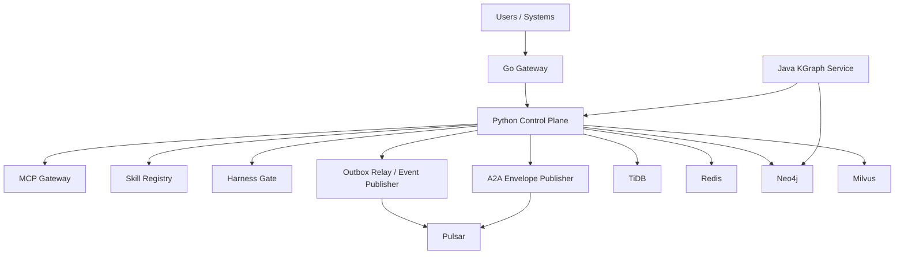

# Technical Architecture

## 1. System Context

EKB is an enterprise-grade AI knowledge platform baseline for large industrial groups, spanning headquarters, regional clouds, and factory edge nodes.

Core objectives:

- Multi-region, high-concurrency access path
- Governed AI tool invocation via MCP
- Skill lifecycle and quality gates before production release
- Multi-language specialization by workload type

## 2. Layered Architecture

## 3. Service Boundaries

### 3.1 Python (Control/Governance Plane)

- API endpoints for health/readiness, skill registration/promotion, MCP invoke, harness evaluate, capacity estimate, audit query, event relay
- Policy-driven control logic and audit persistence
- Outbox + relay for reliable event publication

### 3.2 Java (KGraph / Enterprise reasoning)

- Graph reasoning and knowledge relation synthesis
- Sentinel-based degradation/fallback behavior for controlled failures

### 3.3 Go (Low-latency gateway)

- High-concurrency access entrypoint
- AuthZ and dialogue routing APIs
- Adapter interfaces for cache/event/graph/vector middleware

## 4. Contracts and Compatibility

- OpenAPI contract: `contracts/openapi/control-plane.openapi.yaml`
- Proto contract: `contracts/proto/ekb_contracts.proto`
- Multi-language CI validates basic compatibility and test execution

## 5. Non-functional Architecture Principles

- Isolation first: tenant/region/plant boundaries
- Governance first: MCP policy + audit evidence
- Safe rollout: Harness gates + rollback-ready changes
- Throughput and latency balance: batched middleware access + bounded timeouts
