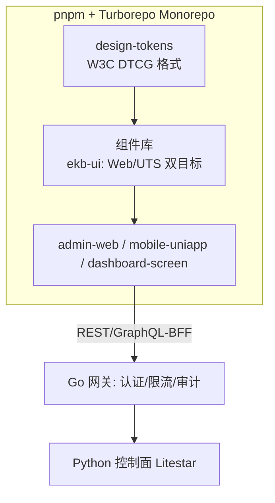

# EKB 前端多端设计方案（互联网大厂标准）

> 定位：本项目当前**无前端代码**（绿地设计）。本方案按大厂前端工程标准给出多端（Web 管理台 / 移动 App / 小程序 / 车间大屏 / IM 机器人）的选型、架构、性能与体验基线，并定义与控制面/网关的接入契约。
> 对标：2025 跨端格局（RN New Architecture 默认化、uni-app x 原生编译、字节 Lynx/腾讯 Kuikly 生产验证、鸿蒙强制跨端支持）、W3C Design Tokens、大厂微前端/Monorepo 实践。

## 1. 技术选型（多端矩阵）

| 端 | 选型 | 理由 | 备选 |
|---|---|---|---|
| Web 管理台（治理面：Skill 注册/评测/审计/容量） | React 18 + Vite + Ant Design + TypeScript | 治理台重表格/表单，antd 生态成熟；Vite 构建快 | Vue3 + Arco |
| 移动 App（一线：工单/质量/巡检问答） | **uni-app x**（UTS 编译原生，一套码出 iOS/Android/**鸿蒙 ArkTS**） | 大厂硬性要求鸿蒙；uni-app x 原生渲染避开 WebView 性能坑 | React Native（Expo，New Architecture） |
| 微信/钉钉小程序 | uni-app x 同仓编译 | 与 App 同仓共码 | Taro |
| 车间大屏（产能/质量看板） | Vue3 + ECharts + WebGL（大数据量） | 大屏生态成熟，60fps 渲染 | — |
| IM 机器人（企业微信/钉钉/飞书） | 直接调 REST + 消息卡片，无前端仓 | 零前端栈成本 | — |

**跨端框架对照结论**：RN New Architecture（JSI/Fabric/TurboModules）与 uni-app x（UTS→原生/ArkTS）是 2025 主流双选；字节 Lynx、腾讯 Kuikly 属大厂自研生产验证栈，非必要不引入。选 uni-app x 的决定性因素是**鸿蒙**。

## 2. 工程架构（大厂标准五件套）

1. **Monorepo**：pnpm workspace + Turborepo 任务编排；tokens/组件库/工具库/app 同仓，语义化版本 + Changesets。
2. **设计系统**：`design-tokens`（W3C DTCG JSON）为唯一视觉源，脚本生成 Web CSS Variables 与 UTS 主题——保证多端品牌一致性；雅迪品牌色/暗色模式/无障碍对比度 ≥ 4.5:1 进 tokens。
3. **微前端**（管理台第二阶段）：治理台按限界上下文拆 qiankun/Module Federation 子应用（skill 域、审计域、容量域），多团队并行不阻塞。
4. **BFF 层**：管理台聚合查询走 Go 网关新增 `/bff/*`（或 P2 只读 GraphQL，见评审报告 §12），避免前端直连 36 个 REST 端点造成 round-trip 放大。
5. **CI/CD**：pnpm lint(type-check+eslint) → vitest 单测 → Playwright e2e → Lighthouse CI 性能门禁 → 分环境发布（dev/staging/prod 与后端环境对齐）。

## 3. 性能预算（门禁化，进 Lighthouse CI）

| 指标 | 预算（管理台） | 预算（移动端） | 手段 |
|---|---|---|---|
| LCP | < 2.5s | < 2.0s | 路由级代码分割、SSR/预渲染（管理台首屏） |
| INP | < 200ms | < 200ms | 虚拟列表（审计/事件万行表格）、Web Worker 检索 |
| CLS | < 0.1 | < 0.1 | 骨架屏、字体 preload |
| 首包 JS | < 200KB gzip | — | 分包 + 依赖审计（禁止 moment/lodash 全量） |
| 冷启动（App） | — | < 1.5s | uni-app x 原生渲染、启动链路瘦身 |
| 缓存命中 | 静态资产命中率 > 90% | — | 内容哈希 + 长缓存 + CDN |

## 4. 安全与风控（前端侧，与评审 §9 风控漏斗衔接）

- 认证：OAuth2.1 + PKCE（P0-4 落地后前端切换）；Token 存内存 + refresh 旋转，**不入 localStorage**（XSS 防线）。
- CSP 严格白名单、子资源完整性（SRI）、依赖 SCAR/锁文件审计（Supply-chain）。
- 接口防刷配合：前端埋点信号（行为序列）+ 服务端设备指纹 SDK，低风险零打扰、高风险自适应验证码。
- 权限：菜单/按钮级 RBAC 渲染 + 服务端二次校验（前端权限仅作体验，不作安全边界）。

## 5. 分阶段路线

| 阶段 | 交付 | 验收 |
|---|---|---|
| M1（4-6 周） | design-tokens + ekb-ui 基础组件 + 管理台 MVP（Skill 注册/评测门禁/审计查询/容量估算四页） | Lighthouse 四项全绿、性能预算进 CI |
| M2（4 周） | 车间大屏（容量/事件飞轮看板）+ 企业微信/钉钉机器人（问答 + 告警卡片） | 大屏 60fps @ 10k 点、机器人告警 P99 < 5s |
| M3（6-8 周） | uni-app x 移动端（工单/巡检问答，鸿蒙适配）+ 微前端拆分 | 鸿蒙真机过检、三端 Tokens 一致性自动化比对 |

## 6. 与后端的接口对齐（前端视角的契约要求）

- 管理台需要的**聚合端点**（建议进 BFF）：`GET /bff/overview`（健康+SLO+outbox+覆盖率一屏）、`GET /bff/skill-detail`（manifest+评测历史+调用统计）。
- 全部列表接口需要**分页/游标 + 排序参数**（当前 `limit` 参数已具备雏形）。
- 错误码规范：`{detail, code, trace_id}` 统一 envelope（Litestar 迁移后 `detail` 已统一）。
- 实时通道：大屏/机器人告警建议 SSE（控制面新增 `/events/stream`，读 Outbox published 流），避免 WebSocket 全双工复杂度。
