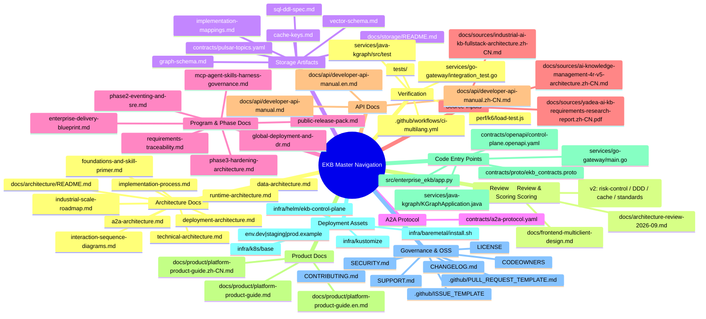

# Master Navigation (Executive / Architect Review)

This page is the single top-level navigation for reviewing design intent, implementation landing, deployment readiness, governance, and code entry points.

## 1. Architecture & Delivery Mindmap

## 2. Fast Review Paths

### A) Executive path (10–15 min)

0. [Architecture Review & Scoring 2026-09](./architecture-review-2026-09.md)
1. [Enterprise Delivery Blueprint](./enterprise-delivery-blueprint.md)
2. [Phase3 Hardening Architecture](./phase3-hardening-architecture.md)
3. [Global Deployment and DR](./global-deployment-and-dr.md)
4. [Public Release Pack](./public-release-pack.md)

### B) Architect path (deep dive)

1. [Architecture Index](./architecture/README.md)
2. [Technical Architecture](./architecture/technical-architecture.md)
3. [Data Architecture](./architecture/data-architecture.md)
4. [Deployment Architecture](./architecture/deployment-architecture.md)
5. [Runtime Architecture](./architecture/runtime-architecture.md)
6. [Implementation Process](./architecture/implementation-process.md)
7. [Interaction Sequence Diagrams](./architecture/interaction-sequence-diagrams.md)
8. [Foundations and Skill Primer](./architecture/foundations-and-skill-primer.md)
9. [A2A Architecture](./architecture/a2a-architecture.md)
10. [Industrial Scale Roadmap](./architecture/industrial-scale-roadmap.md)

### B-2) Storage deep-dive path

1. [Storage Index](./storage/README.md)
2. [SQL DDL Spec](./storage/sql-ddl-spec.md)
3. [Cache Keys Spec](./storage/cache-keys.md)
4. [Pulsar Topic Contract](../contracts/pulsar-topics.yaml)
5. [A2A Protocol Contract](../contracts/a2a-protocol.yaml)
5. [Vector Schema Spec](./storage/vector-schema.md)
6. [Graph Schema Spec](./storage/graph-schema.md)
7. [Implementation Mapping Matrix](./storage/implementation-mappings.md)

### C) Delivery / Ops path

1. [Phase2 Eventing and SRE](./phase2-eventing-and-sre.md)
2. [Global Deployment and DR](./global-deployment-and-dr.md)
3. [Requirements Traceability](./requirements-traceability.md)
4. [Perf k6 README](../perf/k6/README.md)

## 3. Code Entry Points (Direct)

### Control plane

- [`src/enterprise_ekb/app.py`](../src/enterprise_ekb/app.py)
- [`src/enterprise_ekb/config.py`](../src/enterprise_ekb/config.py)
- [`src/enterprise_ekb/policy.py`](../src/enterprise_ekb/policy.py)
- [`src/enterprise_ekb/mcp_gateway.py`](../src/enterprise_ekb/mcp_gateway.py)
- [`src/enterprise_ekb/skill_registry.py`](../src/enterprise_ekb/skill_registry.py)
- [`src/enterprise_ekb/harness.py`](../src/enterprise_ekb/harness.py)
- [`src/enterprise_ekb/event_bus.py`](../src/enterprise_ekb/event_bus.py)
- [`src/enterprise_ekb/tidb_store.py`](../src/enterprise_ekb/tidb_store.py)
- [`src/enterprise_ekb/middleware_clients.py`](../src/enterprise_ekb/middleware_clients.py)

### Java / Go services

- [`services/java-kgraph/src/main/java/com/enterprise/ekb/kgraph/KGraphApplication.java`](../services/java-kgraph/src/main/java/com/enterprise/ekb/kgraph/KGraphApplication.java)
- [`services/java-kgraph/src/main/java/com/enterprise/ekb/kgraph/api/KGraphController.java`](../services/java-kgraph/src/main/java/com/enterprise/ekb/kgraph/api/KGraphController.java)
- [`services/java-kgraph/src/main/java/com/enterprise/ekb/kgraph/service/KGraphReasoningService.java`](../services/java-kgraph/src/main/java/com/enterprise/ekb/kgraph/service/KGraphReasoningService.java)
- [`services/go-gateway/main.go`](../services/go-gateway/main.go)

### API contracts

- [`contracts/openapi/control-plane.openapi.yaml`](../contracts/openapi/control-plane.openapi.yaml)
- [`contracts/proto/ekb_contracts.proto`](../contracts/proto/ekb_contracts.proto)

## 3.1 Source Input Artifacts

- [`docs/sources/industrial-ai-kb-fullstack-architecture.zh-CN.md`](./sources/industrial-ai-kb-fullstack-architecture.zh-CN.md)
- [`docs/sources/ai-knowledge-management-4r-v5-architecture.zh-CN.md`](./sources/ai-knowledge-management-4r-v5-architecture.zh-CN.md)
- [`docs/sources/yadea-ai-kb-requirements-research-report.zh-CN.pdf`](./sources/yadea-ai-kb-requirements-research-report.zh-CN.pdf)

## 4. Deployment Entry Points

- Helm chart: [`infra/helm/ekb-control-plane/`](../infra/helm/ekb-control-plane)
- Helm deployment template: [`infra/helm/ekb-control-plane/templates/deployment.yaml`](../infra/helm/ekb-control-plane/templates/deployment.yaml)
- Helm secret template: [`infra/helm/ekb-control-plane/templates/secret.yaml`](../infra/helm/ekb-control-plane/templates/secret.yaml)
- K8s base manifests: [`infra/k8s/base/`](../infra/k8s/base)
- Kustomize: [`infra/kustomize/`](../infra/kustomize)
- Local compose: [`infra/docker-compose.phase3.yml`](../infra/docker-compose.phase3.yml)
- Environment examples:
  - [`env.dev.example`](../env.dev.example)
  - [`env.staging.example`](../env.staging.example)
  - [`env.prod.example`](../env.prod.example)

## 5. Governance & Contribution Entry Points

- [`LICENSE`](../LICENSE)
- [`SECURITY.md`](../SECURITY.md)
- [`SUPPORT.md`](../SUPPORT.md)
- [`CONTRIBUTING.md`](../CONTRIBUTING.md)
- [`CODEOWNERS`](../CODEOWNERS)
- Issue templates: [`.github/ISSUE_TEMPLATE/`](../.github/ISSUE_TEMPLATE)
- PR template: [`.github/PULL_REQUEST_TEMPLATE.md`](../.github/PULL_REQUEST_TEMPLATE.md)

## 6. Verification Entry Points

- Python tests: [`tests/`](../tests)
- Java tests: [`services/java-kgraph/src/test/`](../services/java-kgraph/src/test)
- Performance tests: [`perf/k6/load-test.js`](../perf/k6/load-test.js)
- CI workflow: [`.github/workflows/ci-multilang.yml`](../.github/workflows/ci-multilang.yml)
