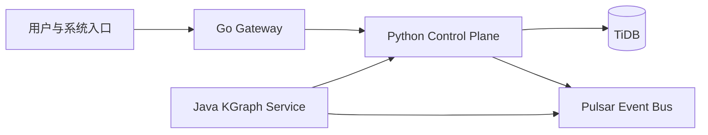
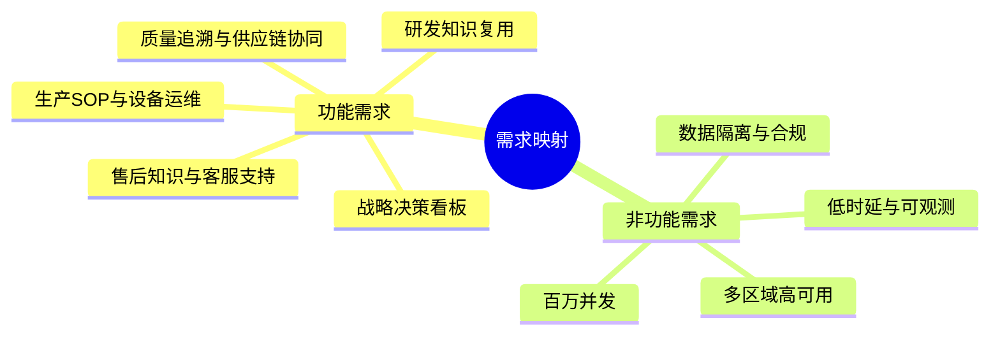

# 开源发布与上线包说明（图文版）

## 一、系统全景图

## 二、核心能力矩阵

| 能力域 | 当前实现 | 三期-2状态 |
|---|---|---|
| MCP/Skill/Harness治理 | Python控制面 | 已落地 |
| 关系库主选型 | TiDB优先 | 已落地 |
| 事件驱动 | Outbox + Relay + Pulsar Publisher | 已落地 |
| 多语言服务 | Java/Python/Go | 已落地 |
| 契约治理 | OpenAPI + Proto + CI | 已落地 |

## 三、需求映射图（雅迪调研 + 架构文档）

## 四、发布检查清单

1. 依赖版本锁定（Python/Java/Go）
2. 多语言测试通过
3. CI流水线通过
4. TiDB与Pulsar连接可用
5. 安全策略与审计链路生效

## 五、公开分享与生产上线成熟度评估（2026-03）

| 维度 | 现状 | 评级 | 说明 |
|---|---|---|---|
| 架构文档完整性 | 多份架构与治理文档已齐备 | A- | 建议补“运维手册索引页” |
| 数据架构落地 | TiDB/Pulsar/Redis/Neo4j/Milvus均有代码落点 | A- | 部分为接口化/基线化实现 |
| 部署架构落地 | K8s/Helm/Kustomize/Compose 完备 | A- | Secret治理需进一步收敛 |
| 多语言工程化 | Python成熟、Java/Go可运行 | B+ | Java/Go业务深度可继续扩展 |
| 安全与合规资产 | 审计链路/策略门禁存在 | B | 建议补 `SECURITY.md` + 威胁模型 |
| 开源发布规范 | CI与文档基础良好 | B | 建议补 LICENSE/CODEOWNERS/SUPPORT |

## 六、必须补齐项（对外正式发布前）

1. 增加一份端到端压测结果与SLO达标报告（k6 + 服务端指标）
2. 增加 DR 演练报告模板与最近一次演练样例
3. 在公开发布前移除生成型临时文件（如 `.DS_Store`、`__pycache__`、`*.pyc`、`target/`）

### 已完成补齐（本轮）

- `LICENSE`、`SECURITY.md`、`SUPPORT.md`、`CODEOWNERS`
- `env.dev.example`、`env.staging.example`、`env.prod.example`
- Helm 敏感变量 SecretRef 注入（含 `secret.yaml` 模板与 `values.yaml` 的 `secrets.*`）

## 七、推荐补强项（持续优化）

- Java KGraph 服务接入真实 Neo4j/Milvus 查询链路与更完整 Spring AI Alibaba 编排
- Go 网关将 Noop 适配器替换为生产客户端实现，并补并发基准测试
- 增加全链路追踪（trace_id 贯穿 Python/Java/Go + Pulsar）
- A2A 消息处理消费者（dispatcher）与幂等性回放测试
