# 基于4R架构的AI知识管理平台V5.0完整架构设计文档

## 文档概述

本文档基于4R架构理论（Rank-系统等级与层次结构设计、Role-组件角色与职责边界、Relation-组件关系与交互模式、Rule-系统规则与约束管理），全面设计AI知识管理平台V5.0版本，涵盖4.0版本所有功能基础上的技术升级与创新。

---

## 目录

1. 4R架构理论基础与系统分析
2. 系统总体架构设计
3. 核心功能组件设计
4. 技术架构与集成方案
5. 项目实施计划管理
6. 系统治理与运维架构

---

## 1. 4R架构理论基础与系统分析

### 1.1 4R架构理论框架定义

```
4R架构理论框架
┌─────────────────────────────────────────────────────────────────────────────────────┐
│                           4R Architecture Theory Framework                          │
├─────────────┬─────────────────┬─────────────────┬─────────────────────────────────────┤
│    RANK     │      ROLE       │    RELATION     │              RULE                   │
│系统等级与层次│   组件角色与    │   组件关系与    │        系统规则与约束管理           │
│  结构设计   │   职责边界      │   交互模式      │                                     │
├─────────────┼─────────────────┼─────────────────┼─────────────────────────────────────┤
│• 分层架构   │• 服务边界定义   │• 同步/异步通信  │• 业务规则引擎                       │
│• 优先级管理 │• 接口职责划分   │• 依赖关系管理   │• 技术标准规范                       │
│• 资源分配   │• 生命周期管理   │• 数据流设计     │• 质量保证体系                       │
│• 容错设计   │• 状态管理策略   │• 事件驱动架构   │• 安全策略制度                       │
│• 扩展策略   │• 功能边界控制   │• 服务编排协调   │• 治理合规要求                       │
└─────────────┴─────────────────┴─────────────────┴─────────────────────────────────────┘

```

### 1.2 系统需求分析与建模

### 1.2.1 业务需求分析图

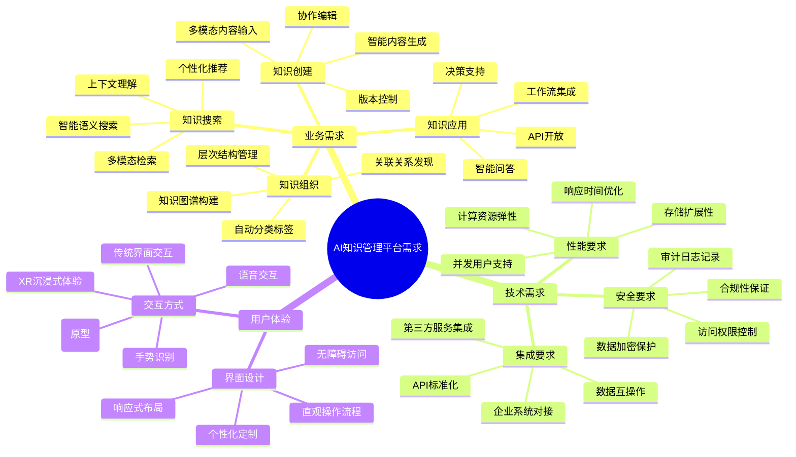

### 1.2.2 用户角色与权限分析图

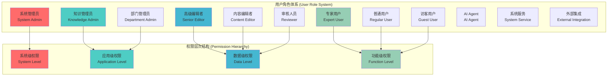

### 1.2.3 4R架构在系统分析中的应用

```
4R架构系统分析应用矩阵

┌─────────────────────────────────────────────────────────────────────────────────┐
│                           4R架构系统分析维度                                     │
└─────────────────────────────────────────────────────────────────────────────────┘

RANK (系统等级与层次结构设计)
┌─────────────────────────────────────────────────────────────────────┐
│ L0 - 基础设施层 (Infrastructure)    │ Kubernetes, 网络, 存储      │
│ L1 - 数据服务层 (Data Services)     │ 数据库, 缓存, 消息队列      │
│ L2 - 平台服务层 (Platform Services) │ 认证, 授权, 监控, 日志      │
│ L3 - 业务服务层 (Business Services) │ 核心业务逻辑, AI服务       │
│ L4 - 应用接入层 (Application Layer) │ API网关, 负载均衡         │
│ L5 - 用户界面层 (Presentation)      │ Web, Mobile, XR界面       │
└─────────────────────────────────────────────────────────────────────┘

ROLE (组件角色与职责边界)
┌─────────────────────────────────────────────────────────────────────┐
│ Gateway Role     │ 流量路由, 协议转换, 安全检查                    │
│ Service Role     │ 业务逻辑处理, 数据操作, 状态管理                │
│ Data Role        │ 数据持久化, 一致性保证, 备份恢复                │
│ AI Role          │ 智能推理, 内容生成, 模型训练                    │
│ Integration Role │ 外部系统对接, 数据同步, 协议适配                │
│ Monitoring Role  │ 健康检查, 指标采集, 告警通知                    │
└─────────────────────────────────────────────────────────────────────┘

RELATION (组件关系与交互模式)
┌─────────────────────────────────────────────────────────────────────┐
│ 同步调用关系     │ HTTP/gRPC同步请求响应                           │
│ 异步消息关系     │ 消息队列异步通信                                │
│ 事件驱动关系     │ 事件发布订阅模式                                │
│ 数据流关系       │ 数据管道和流处理                                │
│ 依赖管理关系     │ 服务依赖和启动顺序                              │
│ 编排协调关系     │ 工作流和任务调度                                │
└─────────────────────────────────────────────────────────────────────┘

RULE (系统规则与约束管理)
┌─────────────────────────────────────────────────────────────────────┐
│ 业务规则         │ 工作流程, 审批流程, 权限控制                    │
│ 技术规则         │ API规范, 数据格式, 通信协议                     │
│ 质量规则         │ 性能SLA, 可用性指标, 错误率阈值                 │
│ 安全规则         │ 认证机制, 加密标准, 审计要求                    │
│ 合规规则         │ 数据保护, 隐私政策, 法规遵循                    │
│ 运维规则         │ 部署标准, 监控策略, 变更管理                    │
└─────────────────────────────────────────────────────────────────────┘

```

### 1.3 V4.0到V5.0功能演进分析

### 1.3.1 功能对比分析图

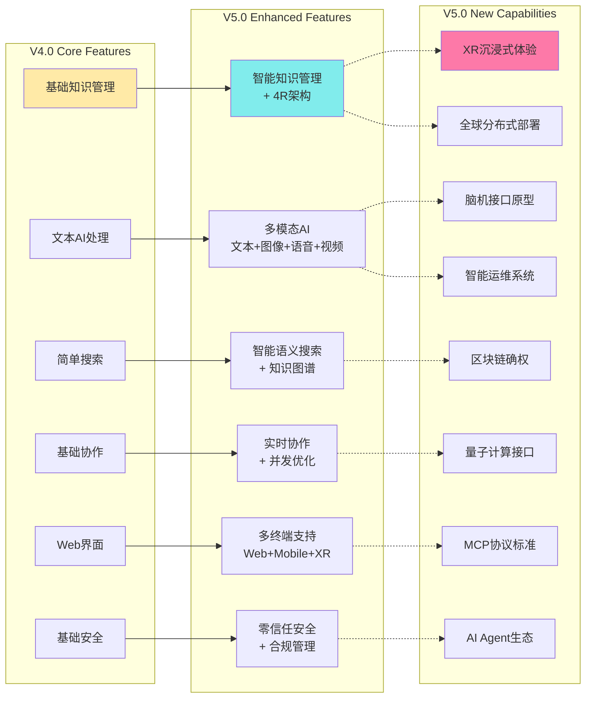

### 1.3.2 技术栈演进对比

```
技术栈演进对比表 (V4.0 → V5.0)

┌──────────────┬────────────────────┬────────────────────┬──────────────────────┐
│   技术层次   │      V4.0版本      │      V5.0版本      │      主要升级点      │
├──────────────┼────────────────────┼────────────────────┼──────────────────────┤
│ 前端技术     │ React + TypeScript │ React + Next.js +  │ • XR界面集成         │
│              │                    │ Three.js + XR SDK  │ • 脑机接口SDK        │
│              │                    │                    │ • PWA支持            │
├──────────────┼────────────────────┼────────────────────┼──────────────────────┤
│ 后端技术     │ Node.js + Express  │ Java+Node.js + FastAPI  │ • 4R架构框架         │
│              │ Python + Flask     │ + Go (性能组件)  │ • MCP协议实现        │
│              │                    │                    │ • 微服务架构         │
├──────────────┼────────────────────┼────────────────────┼──────────────────────┤
│ AI技术       │ OpenAI GPT-3.5     │ GPT-5 + Claude + Gemini  │ • 多模态融合         │
│              │ 基础NLP处理        │ 开源LLM + 自研     │ • 边缘AI推理         │
│              │                    │ 多模态模型         │ • 模型微调平台       │
├──────────────┼────────────────────┼────────────────────┼──────────────────────┤
│ 数据库       │ PostgreSQL +       │ TiDB+Redis Cluster + │ • 向量数据库集群     │
│              │ MongoDB            │ Qdrant + Neo4j +   │ • 图数据库优化       │
│              │                    │ ClickHouse         │ • 时序数据库         │
├──────────────┼────────────────────┼────────────────────┼──────────────────────┤
│ 基础设施     │ Docker + 单云部署  │ Kubernetes + 多云  │ • 云原生架构         │
│              │                    │ + 边缘计算节点  +Pulsar MQ    │ • 全球分布式         │
│              │                    │                    │ • 智能调度系统       │
├──────────────┼────────────────────┼────────────────────┼──────────────────────┤
│ 监控运维     │ 基础监控工具       │ Prometheus +       │ • 全链路追踪         │
│              │                    │ Grafana + Jaeger + │ • AI驱动运维         │
│              │                    │ 智能运维平台       │ • 预测性维护         │
├──────────────┼────────────────────┼────────────────────┼──────────────────────┤
│ 安全技术     │ 传统身份认证       │ 零信任架构 +       │ • 端到端加密         │
│              │                    │ 区块链确权 +       │ • 隐私计算           │
│              │                    │ 隐私计算技术       │ • 合规自动化         │
└──────────────┴────────────────────┴────────────────────┴──────────────────────┘

```

---

## 2. 系统总体架构设计

### 2.1 4R架构总体设计图

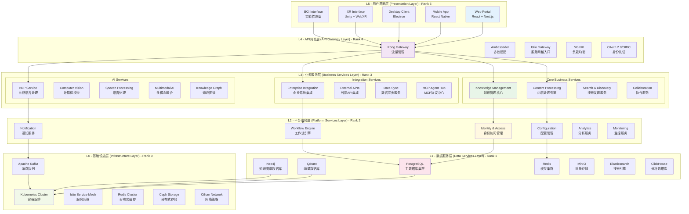

### 2.2 系统部署架构图

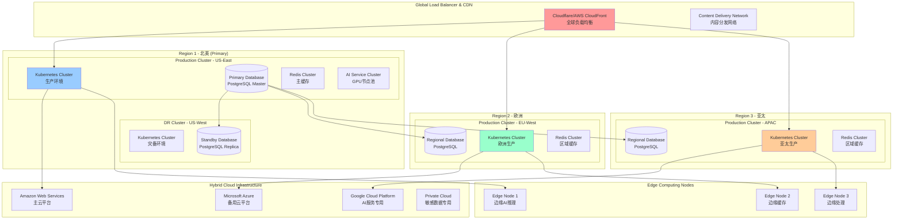

### 2.3 微服务架构图

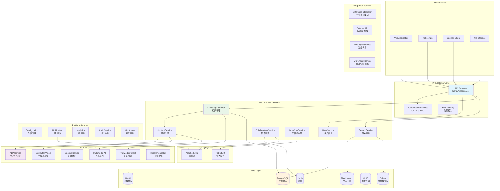

### 2.4 数据架构设计图

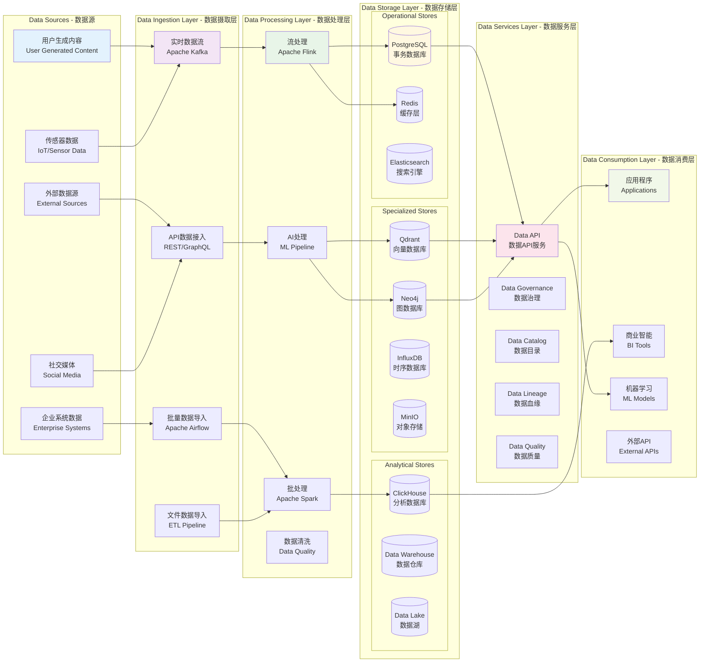

---

## 3. 核心功能组件设计

### 3.1 知识管理核心组件架构

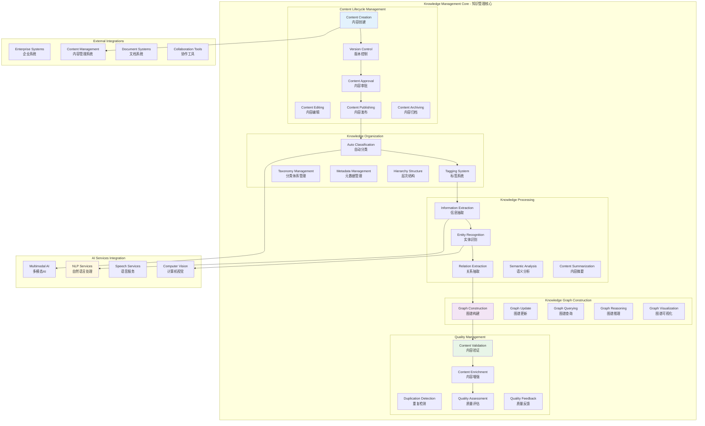

### 3.2 多模态AI处理组件架构

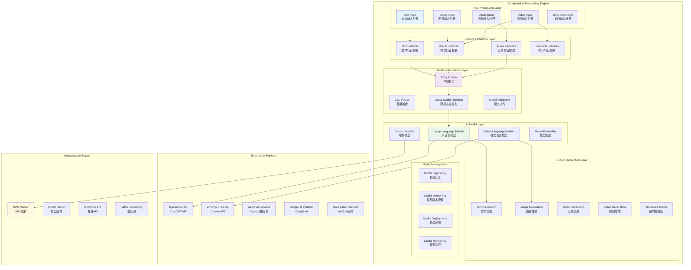

### 3.3 实时协作系统架构

```mermaid
graph TB
    subgraph "Real-time Collaboration System"
        subgraph "Connection Management"
            WS_MANAGER[WebSocket Manager<br/>WebSocket连接管理]
            SESSION_MGR[Session Manager<br/>会话管理]
            PRESENCE[Presence Service<br/>在线状态服务]
            HEARTBEAT[Heartbeat Service<br/>心跳检测]
        end

        subgraph "Collaborative Editing"
            OT_ENGINE[Operational Transform<br/>操作变换引擎]
            CRDT_ENGINE[CRDT Engine<br/>CRDT冲突解决]
            DIFF_ENGINE[Diff Engine<br/>差异计算引擎]
            MERGE_ENGINE[Merge Engine<br/>合并引擎]
        end

        subgraph "Real-time Communication"
            MESSAGE_ROUTER[Message Router<br/>消息路由]
            BROADCAST[Broadcast Service<br/>广播服务]
            P2P_COMM[P2P Communication<br/>点对点通信]
            VOICE_CHAT[Voice Chat<br/>语音聊天]
            VIDEO_CONF[Video Conference<br/>视频会议]
        end

        subgraph "Synchronization"
            STATE_SYNC[State Synchronization<br/>状态同步]
            CONFLICT_RES[Conflict Resolution<br/>冲突解决]
            SNAPSHOT[Snapshot Service<br/>快照服务]
            RECOVERY[Recovery Service<br/>恢复服务]
        end

        subgraph "Notification & Events"
            EVENT_BUS[Event Bus<br/>事件总线]
            NOTIFICATION[Notification Service<br/>通知服务]
            ACTIVITY_LOG[Activity Logger<br/>活动日志]
            AUDIT_TRAIL[Audit Trail<br/>审计跟踪]
        end

        subgraph "Permissions & Security"
            COLLAB_AUTH[Collaboration Auth<br/>协作授权]
            DOCUMENT_LOCK[Document Locking<br/>文档锁定]
            ACCESS_CONTROL[Access Control<br/>访问控制]
            SECURITY_FILTER[Security Filter<br/>安全过滤]
        end
    end

    subgraph "Data Layer"
        REDIS_CLUSTER[(Redis Cluster<br/>分布式缓存)]
        POSTGRES[(PostgreSQL<br/>持久化存储)]
        MESSAGE_QUEUE[Apache Kafka<br/>消息队列]
        BLOB_STORE[(Object Storage<br/>对象存储)]
    end

    subgraph "Client Applications"
        WEB_CLIENT[Web Client<br/>Web客户端]
        MOBILE_CLIENT[Mobile Client<br/>移动客户端]
        DESKTOP_CLIENT[Desktop Client<br/>桌面客户端]
        XR_CLIENT[XR Client<br/>XR客户端]
    end

    %% Connections
    WEB_CLIENT --> WS_MANAGER
    MOBILE_CLIENT --> WS_MANAGER
    DESKTOP_CLIENT --> WS_MANAGER
    XR_CLIENT --> WS_MANAGER

    WS_MANAGER --> SESSION_MGR
    SESSION_MGR --> PRESENCE

    OT_ENGINE --> STATE_SYNC
    CRDT_ENGINE --> STATE_SYNC
    STATE_SYNC --> REDIS_CLUSTER

    MESSAGE_ROUTER --> MESSAGE_QUEUE
    BROADCAST --> MESSAGE_QUEUE
    EVENT_BUS --> MESSAGE_QUEUE

    SNAPSHOT --> POSTGRES
    AUDIT_TRAIL --> POSTGRES

    style WS_MANAGER fill:#e3f2fd
    style OT_ENGINE fill:#f3e5f5
    style STATE_SYNC fill:#e8f5e8
    style REDIS_CLUSTER fill:#fff8e1

```

### 3.4 XR沉浸式体验组件架构

```mermaid
graph TB
    subgraph "XR Immersive Experience Platform"
        subgraph "XR Interface Layer"
            VR_INTERFACE[VR Interface<br/>虚拟现实界面]
            AR_INTERFACE[AR Interface<br/>增强现实界面]
            MR_INTERFACE[MR Interface<br/>混合现实界面]
            WEB_XR[WebXR Interface<br/>Web XR界面]
        end

        subgraph "3D Rendering Engine"
            SCENE_MANAGER[Scene Manager<br/>场景管理器]
            RENDER_ENGINE[Render Engine<br/>渲染引擎]
            PHYSICS_ENGINE[Physics Engine<br/>物理引擎]
            ANIMATION[Animation System<br/>动画系统]
            LIGHTING[Lighting System<br/>光照系统]
        end

        subgraph "Spatial Computing"
            SPACE_MAP[Spatial Mapping<br/>空间映射]
            OBJECT_TRACK[Object Tracking<br/>对象跟踪]
            GESTURE_REC[Gesture Recognition<br/>手势识别]
            EYE_TRACK[Eye Tracking<br/>眼动跟踪]
            VOICE_CMD[Voice Commands<br/>语音命令]
        end

        subgraph "Knowledge Visualization"
            3D_KNOWLEDGE[3D Knowledge Graph<br/>3D知识图谱]
            INFO_VIS[Information Visualization<br/>信息可视化]
            DATA_VIS[Data Visualization<br/>数据可视化]
            CONCEPT_MAP[Concept Mapping<br/>概念映射]
            MIND_MAP[3D Mind Map<br/>3D思维导图]
        end

        subgraph "Interaction Systems"
            HAND_INTERACT[Hand Interaction<br/>手部交互]
            CONTROLLER[Controller Input<br/>控制器输入]
            HAPTIC[Haptic Feedback<br/>触觉反馈]
            SPATIAL_UI[Spatial UI<br/>空间用户界面]
            MULTI_USER[Multi-user Support<br/>多用户支持]
        end

        subgraph "Content Management"
            3D_ASSETS[3D Asset Manager<br/>3D资产管理]
            TEXTURE_MGR[Texture Manager<br/>纹理管理]
            MODEL_LOADER[Model Loader<br/>模型加载器]
            CONTENT_STREAM[Content Streaming<br/>内容流媒体]
            OPTIMIZATION[Performance Optimization<br/>性能优化]
        end
    end

    subgraph "XR Hardware Integration"
        OCULUS[Meta Quest/Oculus<br/>Meta VR设备]
        HOLOLENS[Microsoft HoloLens<br/>微软全息眼镜]
        MAGIC_LEAP[Magic Leap<br/>Magic Leap设备]
        APPLE_VR[Apple Vision Pro<br/>苹果VR设备]
        PICO[Pico VR<br/>字节跳动VR]
    end

    subgraph "Development Frameworks"
        UNITY[Unity 3D Engine<br/>Unity引擎]
        UNREAL[Unreal Engine<br/>虚幻引擎]
        WEBXR_API[WebXR API<br/>Web XR API]
        OPENXR[OpenXR Standard<br/>OpenXR标准]
        THREE_JS[Three.js<br/>Web 3D库]
    end

    subgraph "Cloud Services"
        XR_CLOUD[XR Cloud Rendering<br/>XR云渲染]
        EDGE_COMPUTE[Edge Computing<br/>边缘计算]
        STREAM_SERVICE[Streaming Service<br/>流媒体服务]
        SPATIAL_ANCHOR[Spatial Anchors<br/>空间锚点]
    end

    %% Connections
    VR_INTERFACE --> SCENE_MANAGER
    AR_INTERFACE --> SCENE_MANAGER
    MR_INTERFACE --> SCENE_MANAGER

    SCENE_MANAGER --> RENDER_ENGINE
    RENDER_ENGINE --> 3D_KNOWLEDGE

    SPACE_MAP --> SPATIAL_UI
    GESTURE_REC --> HAND_INTERACT

    3D_ASSETS --> UNITY
    RENDER_ENGINE --> UNREAL
    WEB_XR --> WEBXR_API

    VR_INTERFACE --> OCULUS
    AR_INTERFACE --> HOLOLENS
    MR_INTERFACE --> MAGIC_LEAP

    RENDER_ENGINE --> XR_CLOUD
    CONTENT_STREAM --> EDGE_COMPUTE

    style VR_INTERFACE fill:#e3f2fd
    style RENDER_ENGINE fill:#f3e5f5
    style 3D_KNOWLEDGE fill:#e8f5e8
    style UNITY fill:#fff8e1

```

---

## 4. 技术架构与集成方案

### 4.1 云原生技术架构图

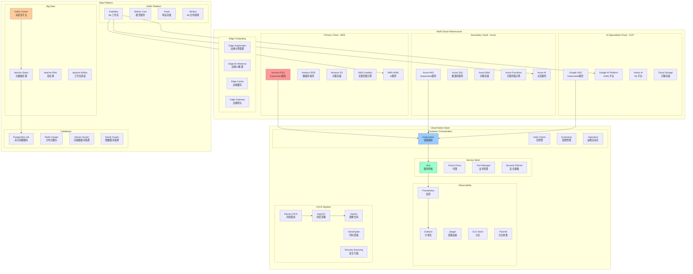

### 4.2 安全架构设计图

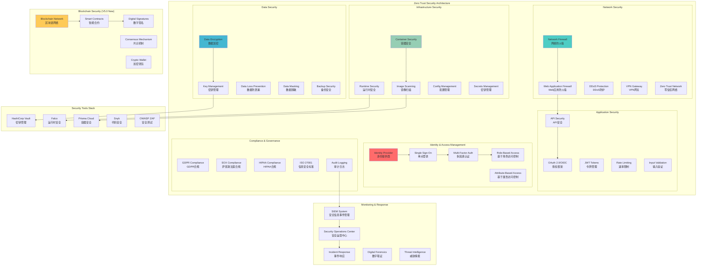

### 4.3 MCP协议集成架构

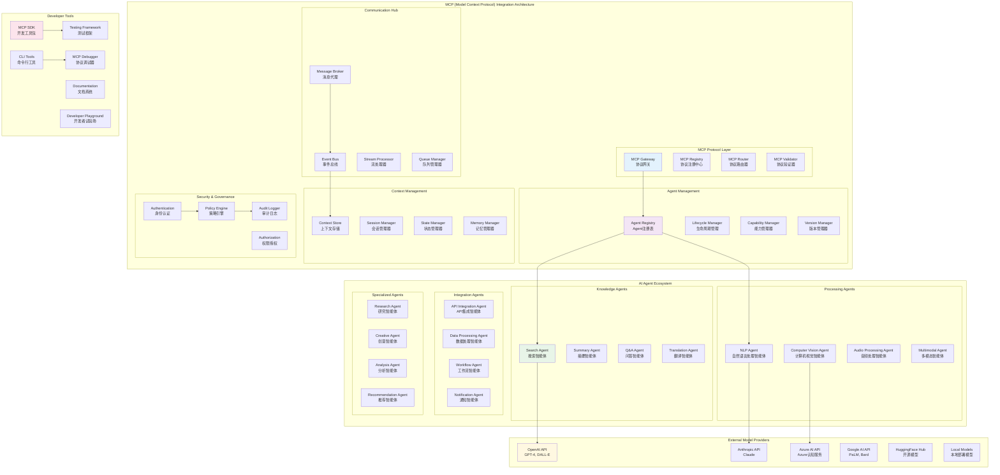

### 4.4 数据集成与ETL架构

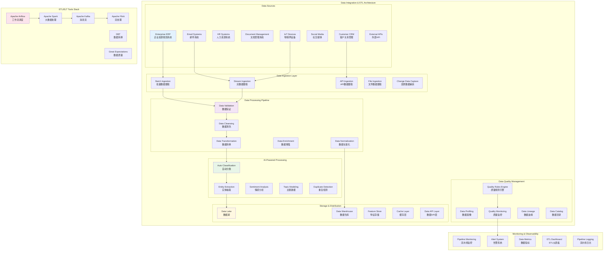

### 4.5 性能优化架构

```mermaid
graph TB
    subgraph "Performance Optimization Architecture"
        subgraph "Frontend Optimization"
            CDN[Content Delivery Network<br/>内容分发网络]
            CACHE_STRATEGY[Client-Side Caching<br/>客户端缓存]
            LAZY_LOADING[Lazy Loading<br/>懒加载]
            CODE_SPLITTING[Code Splitting<br/>代码分割]
            IMAGE_OPTIMIZATION[Image Optimization<br/>图片优化]
            PWA[Progressive Web App<br/>渐进式Web应用]
        end

        subgraph "API & Service Optimization"
            API_GATEWAY_CACHE[API Gateway Cache<br/>API网关缓存]
            RESPONSE_COMPRESSION[Response Compression<br/>响应压缩]
            REQUEST_BATCHING[Request Batching<br/>请求批处理]
            CONNECTION_POOLING[Connection Pooling<br/>连接池]
            ASYNC_PROCESSING[Async Processing<br/>异步处理]
        end

        subgraph "Database Optimization"
            QUERY_OPTIMIZATION[Query Optimization<br/>查询优化]
            INDEX_STRATEGY[Index Strategy<br/>索引策略]
            PARTITIONING[Database Partitioning<br/>数据库分区]
            READ_REPLICAS[Read Replicas<br/>只读副本]
            SHARDING[Database Sharding<br/>数据库分片]
            CACHE_LAYERS[Multi-Level Cache<br/>多级缓存]
        end

        subgraph "AI Model Optimization"
            MODEL_COMPRESSION[Model Compression<br/>模型压缩]
            QUANTIZATION[Model Quantization<br/>模型量化]
            PRUNING[Model Pruning<br/>模型剪枝]
            DISTILLATION[Knowledge Distillation<br/>知识蒸馏]
            PARALLEL_INFERENCE[Parallel Inference<br/>并行推理]
            EDGE_DEPLOYMENT[Edge Deployment<br/>边缘部署]
        end

        subgraph "Infrastructure Optimization"
            AUTO_SCALING[Auto Scaling<br/>自动扩缩容]
            RESOURCE_OPTIMIZATION[Resource Optimization<br/>资源优化]
            LOAD_BALANCING[Intelligent Load Balancing<br/>智能负载均衡]
            CONTAINER_OPTIMIZATION[Container Optimization<br/>容器优化]
            NETWORK_OPTIMIZATION[Network Optimization<br/>网络优化]
        end

        subgraph "Monitoring & Analytics"
            PERFORMANCE_MONITORING[Performance Monitoring<br/>性能监控]
            APM[Application Performance Monitoring<br/>应用性能监控]
            REAL_USER_MONITORING[Real User Monitoring<br/>真实用户监控]
            SYNTHETIC_MONITORING[Synthetic Monitoring<br/>合成监控]
            PERFORMANCE_ANALYTICS[Performance Analytics<br/>性能分析]
        end
    end

    subgraph "Performance Tools Stack"
        LIGHTHOUSE[Google Lighthouse<br/>性能审计]
        WEB_VITALS[Web Vitals<br/>Web性能指标]
        NEW_RELIC[New Relic<br/>APM工具]
        DATADOG[Datadog<br/>监控平台]
        GRAFANA_DASH[Grafana Dashboard<br/>性能仪表板]
    end

    subgraph "Optimization Strategies"
        PRELOADING[Resource Preloading<br/>资源预加载]
        PREFETCHING[Data Prefetching<br/>数据预取]
        MEMOIZATION[Memoization<br/>记忆化]
        DEBOUNCING[Request Debouncing<br/>请求防抖]
        THROTTLING[Rate Throttling<br/>速率限制]
    end

    %% Optimization Flow
    CDN --> CACHE_STRATEGY
    CACHE_STRATEGY --> LAZY_LOADING

    API_GATEWAY_CACHE --> RESPONSE_COMPRESSION
    RESPONSE_COMPRESSION --> ASYNC_PROCESSING

    QUERY_OPTIMIZATION --> INDEX_STRATEGY
    INDEX_STRATEGY --> READ_REPLICAS

    MODEL_COMPRESSION --> QUANTIZATION
    QUANTIZATION --> EDGE_DEPLOYMENT

    AUTO_SCALING --> LOAD_BALANCING
    LOAD_BALANCING --> NETWORK_OPTIMIZATION

    PERFORMANCE_MONITORING --> APM
    APM --> NEW_RELIC

    style CDN fill:#ff6b6b
    style API_GATEWAY_CACHE fill:#4ecdc4
    style QUERY_OPTIMIZATION fill:#45b7d1
    style MODEL_COMPRESSION fill:#96ceb4
    style AUTO_SCALING fill:#feca57
    style PERFORMANCE_MONITORING fill:#ff9ff3

```

---

## 5. 项目实施计划管理

### 5.1 项目总体时间规划图

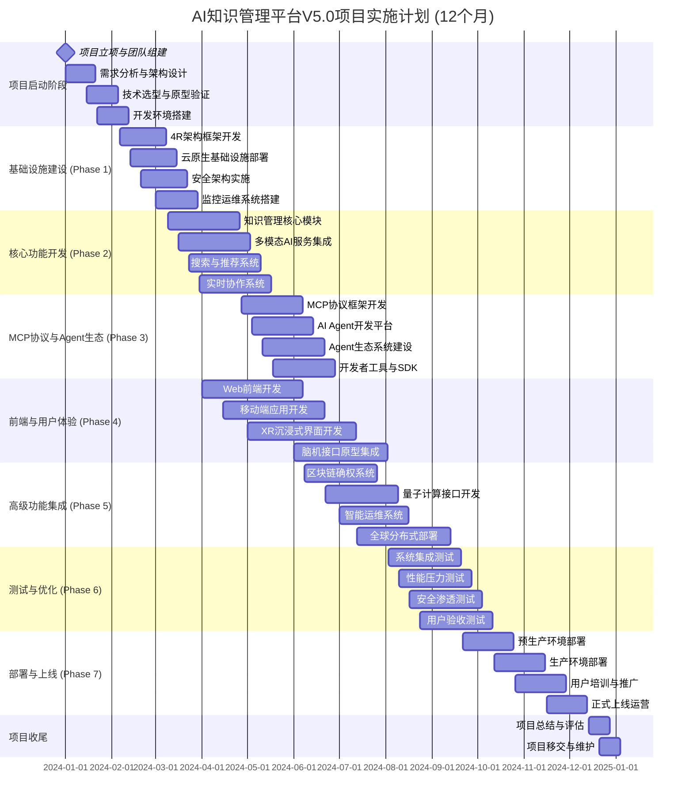

### 5.2 团队组织架构图

```mermaid
graph TB
    subgraph "项目治理层"
        PMO[项目管理办公室<br/>PMO]
        STEERING[指导委员会<br/>Steering Committee]
        ARCHITECT[架构委员会<br/>Architecture Board]
    end

    subgraph "项目管理层"
        PM[项目总监<br/>Project Director]
        TPM1[技术项目经理<br/>Technical PM]
        TPM2[产品项目经理<br/>Product PM]
        QM[质量经理<br/>Quality Manager]
    end

    subgraph "核心开发团队"
        subgraph "架构团队 (8人)"
            CHIEF_ARCH[首席架构师<br/>Chief Architect]
            SYS_ARCH[系统架构师 (2人)<br/>System Architect]
            AI_ARCH[AI架构师 (2人)<br/>AI Architect]
            FRONTEND_ARCH[前端架构师<br/>Frontend Architect]
            DATA_ARCH[数据架构师<br/>Data Architect]
            SEC_ARCH[安全架构师<br/>Security Architect]
        end

        subgraph "后端开发团队 (15人)"
            BACKEND_LEAD[后端开发负责人<br/>Backend Lead]
            BACKEND_DEV[后端开发工程师 (10人)<br/>Backend Developer]
            API_DEV[API开发工程师 (2人)<br/>API Developer]
            MCP_DEV[MCP协议开发工程师 (2人)<br/>MCP Developer]
        end

        subgraph "AI/ML团队 (12人)"
            ML_LEAD[ML团队负责人<br/>ML Lead]
            ML_ENG[机器学习工程师 (6人)<br/>ML Engineer]
            NLP_ENG[NLP工程师 (3人)<br/>NLP Engineer]
            CV_ENG[计算机视觉工程师 (2人)<br/>CV Engineer]
            MLOps[MLOps工程师<br/>MLOps Engineer]
        end

        subgraph "前端开发团队 (10人)"
            FRONTEND_LEAD[前端开发负责人<br/>Frontend Lead]
            WEB_DEV[Web开发工程师 (4人)<br/>Web Developer]
            MOBILE_DEV[移动端开发工程师 (3人)<br/>Mobile Developer]
            XR_DEV[XR开发工程师 (2人)<br/>XR Developer]
            UI_ENG[UI工程师<br/>UI Engineer]
        end

        subgraph "数据团队 (8人)"
            DATA_LEAD[数据团队负责人<br/>Data Lead]
            DATA_ENG[数据工程师 (4人)<br/>Data Engineer]
            DATA_SCI[数据科学家 (2人)<br/>Data Scientist]
            BI_ENG[BI工程师<br/>BI Engineer]
        end
    end

    subgraph "支撑团队"
        subgraph "DevOps/SRE团队 (8人)"
            DEVOPS_LEAD[DevOps负责人<br/>DevOps Lead]
            DEVOPS_ENG[DevOps工程师 (4人)<br/>DevOps Engineer]
            SRE[SRE工程师 (3人)<br/>SRE Engineer]
        end

        subgraph "测试团队 (8人)"
            QA_LEAD[测试负责人<br/>QA Lead]
            QA_ENG[测试工程师 (4人)<br/>QA Engineer]
            AUTO_TEST[自动化测试工程师 (2人)<br/>Automation Engineer]
            PERF_TEST[性能测试工程师<br/>Performance Tester]
        end

        subgraph "产品设计团队 (6人)"
            PRODUCT_LEAD[产品负责人<br/>Product Lead]
            PM_PRODUCT[产品经理 (2人)<br/>Product Manager]
            UX_DESIGNER[UX设计师 (2人)<br/>UX Designer]
            UI_DESIGNER[UI设计师<br/>UI Designer]
        end

        subgraph "运营支持团队 (5人)"
            OPS_LEAD[运营负责人<br/>Operations Lead]
            TECH_WRITER[技术文档工程师<br/>Technical Writer]
            TRAINING[培训专员<br/>Training Specialist]
            SUPPORT[技术支持工程师 (2人)<br/>Support Engineer]
        end
    end

    %% 汇报关系
    STEERING --> PM
    PMO --> PM
    ARCHITECT --> CHIEF_ARCH

    PM --> TPM1
    PM --> TPM2
    PM --> QM

    TPM1 --> BACKEND_LEAD
    TPM1 --> ML_LEAD
    TPM1 --> DATA_LEAD
    TPM1 --> DEVOPS_LEAD

    TPM2 --> FRONTEND_LEAD
    TPM2 --> PRODUCT_LEAD

    QM --> QA_LEAD

    CHIEF_ARCH --> SYS_ARCH
    CHIEF_ARCH --> AI_ARCH

    BACKEND_LEAD --> BACKEND_DEV
    ML_LEAD --> ML_ENG
    FRONTEND_LEAD --> WEB_DEV
    DATA_LEAD --> DATA_ENG

    style PM fill:#ff6b6b
    style CHIEF_ARCH fill:#4ecdc4
    style BACKEND_LEAD fill:#45b7d1
    style ML_LEAD fill:#96ceb4
    style FRONTEND_LEAD fill:#feca57

```

### 5.3 里程碑管理图

```mermaid
graph LR
    subgraph "Phase 1 - 基础建设阶段"
        M1[里程碑1<br/>4R架构框架完成<br/>2024-03-08]
        M2[里程碑2<br/>基础设施部署完成<br/>2024-03-29]
    end

    subgraph "Phase 2 - 核心功能阶段"
        M3[里程碑3<br/>知识管理核心完成<br/>2024-04-26]
        M4[里程碑4<br/>多模态AI集成完成<br/>2024-05-17]
    end

    subgraph "Phase 3 - MCP生态阶段"
        M5[里程碑5<br/>MCP协议框架完成<br/>2024-06-07]
        M6[里程碑6<br/>Agent生态系统完成<br/>2024-06-28]
    end

    subgraph "Phase 4 - 用户体验阶段"
        M7[里程碑7<br/>前端应用完成<br/>2024-07-12]
        M8[里程碑8<br/>XR界面集成完成<br/>2024-08-02]
    end

    subgraph "Phase 5 - 高级功能阶段"
        M9[里程碑9<br/>区块链系统完成<br/>2024-08-16]
        M10[里程碑10<br/>全球部署完成<br/>2024-09-13]
    end

    subgraph "Phase 6 - 测试优化阶段"
        M11[里程碑11<br/>系统测试完成<br/>2024-10-11]
        M12[里程碑12<br/>性能优化完成<br/>2024-10-25]
    end

    subgraph "Phase 7 - 上线阶段"
        M13[里程碑13<br/>预生产部署完成<br/>2024-11-15]
        M14[里程碑14<br/>正式上线完成<br/>2024-12-13]
    end

    M1 --> M2
    M2 --> M3
    M3 --> M4
    M4 --> M5
    M5 --> M6
    M6 --> M7
    M7 --> M8
    M8 --> M9
    M9 --> M10
    M10 --> M11
    M11 --> M12
    M12 --> M13
    M13 --> M14

    style M1 fill:#e3f2fd
    style M4 fill:#f3e5f5
    style M6 fill:#e8f5e8
    style M8 fill:#fff8e1
    style M10 fill:#fce4ec
    style M12 fill:#f1f8e9
    style M14 fill:#ff6b6b

```

### 5.4 风险管理矩阵

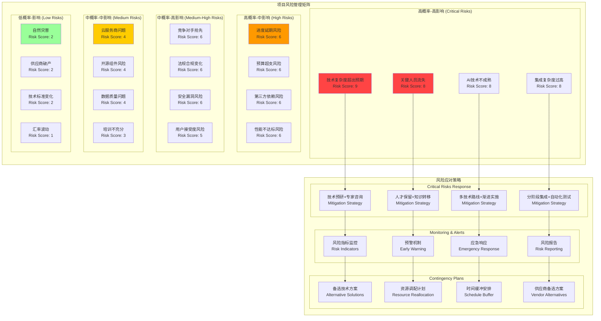

### 5.5 资源分配与预算管理

```mermaid
graph TB
    subgraph "项目预算分配 (总预算: 2000万元)"
        subgraph "人力成本 (1200万元 - 60%)"
            SALARY[核心团队薪资<br/>800万元]
            TRAINING[培训发展<br/>150万元]
            CONSULTANT[外部顾问<br/>100万元]
            BONUS[激励奖金<br/>150万元]
        end

        subgraph "技术基础设施 (500万元 - 25%)"
            CLOUD[云服务费用<br/>300万元]
            SOFTWARE[软件许可<br/>100万元]
            HARDWARE[硬件设备<br/>50万元]
            THIRD_PARTY[第三方服务<br/>50万元]
        end

        subgraph "研发支出 (200万元 - 10%)"
            PROTOTYPE[原型开发<br/>80万元]
            TESTING[测试验证<br/>60万元]
            PATENT[专利申请<br/>30万元]
            ACADEMIC[学术合作<br/>30万元]
        end

        subgraph "风险准备金 (100万元 - 5%)"
            TECH_RISK[技术风险缓解<br/>60万元]
            SCHEDULE_RISK[进度延期缓冲<br/>40万元]
        end
    end

    subgraph "季度预算分布"
        Q1[Q1预算<br/>600万元 (30%)]
        Q2[Q2预算<br/>500万元 (25%)]
        Q3[Q3预算<br/>500万元 (25%)]
        Q4[Q4预算<br/>400万元 (20%)]
    end

    subgraph "成本控制机制"
        BUDGET_TRACK[预算跟踪<br/>Budget Tracking]
        COST_CONTROL[成本控制<br/>Cost Control]
        VARIANCE_ANALYSIS[差异分析<br/>Variance Analysis]
        APPROVAL_PROCESS[审批流程<br/>Approval Process]
    end

    subgraph "ROI预测"
        INVESTMENT[总投资<br/>2000万元]
        RECOVERY_TIME[投资回收期<br/>18个月]
        YEAR1_SAVING[第一年节省<br/>2000万元]
        YEAR2_REVENUE[第二年收入<br/>1.2亿元]
        YEAR3_REVENUE[第三年收入<br/>3.5亿元]
    end

    %% Budget Flow
    SALARY --> Q1
    CLOUD --> Q1
    PROTOTYPE --> Q2
    TRAINING --> Q2

    Q1 --> BUDGET_TRACK
    Q2 --> BUDGET_TRACK
    Q3 --> COST_CONTROL
    Q4 --> VARIANCE_ANALYSIS

    INVESTMENT --> RECOVERY_TIME
    RECOVERY_TIME --> YEAR1_SAVING
    YEAR1_SAVING --> YEAR2_REVENUE
    YEAR2_REVENUE --> YEAR3_REVENUE

    style SALARY fill:#e3f2fd
    style CLOUD fill:#f3e5f5
    style Q1 fill:#e8f5e8
    style INVESTMENT fill:#fff8e1

```

---

## 6. 系统治理与运维架构

### 6.1 系统监控与观测架构

```mermaid
graph TB
    subgraph "Observability & Monitoring Architecture"
        subgraph "Data Collection Layer"
            METRICS_COLLECTOR[Metrics Collection<br/>指标收集]
            LOG_COLLECTOR[Log Collection<br/>日志收集]
            TRACE_COLLECTOR[Trace Collection<br/>链路追踪收集]
            EVENT_COLLECTOR[Event Collection<br/>事件收集]
            BUSINESS_METRICS[Business Metrics<br/>业务指标收集]
        end

        subgraph "Data Processing Layer"
            METRICS_PROCESSOR[Metrics Processing<br/>指标处理]
            LOG_PROCESSOR[Log Processing<br/>日志处理]
            TRACE_PROCESSOR[Trace Processing<br/>链路处理]
            ANOMALY_DETECTION[Anomaly Detection<br/>异常检测]
            CORRELATION_ENGINE[Correlation Engine<br/>关联分析引擎]
        end

        subgraph "Storage Layer"
            TSDB[Time Series DB<br/>时序数据库 (Prometheus)]
            LOG_STORAGE[Log Storage<br/>日志存储 (Elasticsearch)]
            TRACE_STORAGE[Trace Storage<br/>链路存储 (Jaeger)]
            METRICS_STORAGE[Long-term Storage<br/>长期存储 (Thanos)]
        end

        subgraph "Analysis & Alerting"
            ALERT_MANAGER[Alert Manager<br/>告警管理]
            NOTIFICATION[Notification System<br/>通知系统]
            SLA_MONITOR[SLA Monitoring<br/>SLA监控]
            CAPACITY_PLANNING[Capacity Planning<br/>容量规划]
            ROOT_CAUSE[Root Cause Analysis<br/>根因分析]
        end

        subgraph "Visualization & Dashboard"
            GRAFANA[Grafana Dashboards<br/>可视化仪表板]
            KIBANA[Kibana<br/>日志分析界面]
            CUSTOM_DASH[Custom Dashboard<br/>自定义仪表板]
            MOBILE_DASH[Mobile Dashboard<br/>移动端监控]
        end

        subgraph "AI-Powered Operations"
            AIOPS_PLATFORM[AIOps Platform<br/>AI运维平台]
            PREDICTIVE_ANALYTICS[Predictive Analytics<br/>预测分析]
            INTELLIGENT_ALERTS[Intelligent Alerting<br/>智能告警]
            AUTOMATED_REMEDIATION[Auto Remediation<br/>自动修复]
        end
    end

    subgraph "Monitoring Tools Stack"
        PROMETHEUS[Prometheus<br/>指标监控]
        GRAFANA_TOOL[Grafana<br/>可视化]
        ELK[ELK Stack<br/>日志监控]
        JAEGER[Jaeger<br/>分布式追踪]
        DATADOG_TOOL[Datadog<br/>APM监控]
        NEW_RELIC_TOOL[New Relic<br/>应用监控]
    end

    subgraph "Alert Channels"
        EMAIL[Email Alerts<br/>邮件告警]
        SMS[SMS Alerts<br/>短信告警]
        SLACK[Slack Integration<br/>Slack集成]
        WEBHOOK[Webhook<br/>Webhook回调]
        MOBILE_PUSH[Mobile Push<br/>移动推送]
    end

    %% Data Flow
    METRICS_COLLECTOR --> METRICS_PROCESSOR
    LOG_COLLECTOR --> LOG_PROCESSOR
    TRACE_COLLECTOR --> TRACE_PROCESSOR

    METRICS_PROCESSOR --> TSDB
    LOG_PROCESSOR --> LOG_STORAGE
    TRACE_PROCESSOR --> TRACE_STORAGE

    TSDB --> GRAFANA
    LOG_STORAGE --> KIBANA

    ANOMALY_DETECTION --> ALERT_MANAGER
    ALERT_MANAGER --> EMAIL
    ALERT_MANAGER --> SMS
    ALERT_MANAGER --> SLACK

    AIOPS_PLATFORM --> PREDICTIVE_ANALYTICS
    PREDICTIVE_ANALYTICS --> INTELLIGENT_ALERTS

    PROMETHEUS --> TSDB
    ELK --> LOG_STORAGE
    JAEGER --> TRACE_STORAGE

    style METRICS_COLLECTOR fill:#e3f2fd
    style AIOPS_PLATFORM fill:#f3e5f5
    style ALERT_MANAGER fill:#e8f5e8
    style PROMETHEUS fill:#fff8e1

```

### 6.2 DevOps/GitOps流水线架构

```mermaid
graph LR
    subgraph "DevOps/GitOps Pipeline Architecture"
        subgraph "Source Code Management"
            GIT_REPO[Git Repository<br/>GitLab/GitHub]
            BRANCH_STRATEGY[Branch Strategy<br/>Git Flow]
            CODE_REVIEW[Code Review<br/>Merge Request]
            VERSION_TAG[Version Tagging<br/>Semantic Versioning]
        end

        subgraph "CI Pipeline"
            TRIGGER[Pipeline Trigger<br/>Webhook/Schedule]
            CODE_CHECKOUT[Code Checkout<br/>源码检出]
            DEPENDENCY[Dependency Install<br/>依赖安装]
            UNIT_TEST[Unit Testing<br/>单元测试]
            CODE_ANALYSIS[Code Analysis<br/>SonarQube]
            SECURITY_SCAN[Security Scan<br/>SAST/DAST]
            BUILD[Build Artifacts<br/>构建制品]
            CONTAINER_BUILD[Container Build<br/>Docker镜像构建]
            IMAGE_SCAN[Image Scanning<br/>容器镜像安全扫描]
            REGISTRY_PUSH[Registry Push<br/>推送到镜像仓库]
        end

        subgraph "CD Pipeline"
            ENV_PROMOTION[Environment Promotion<br/>环境提升]
            CONFIG_DEPLOY[Config Deployment<br/>配置部署]
            APP_DEPLOY[Application Deployment<br/>应用部署]
            HEALTH_CHECK[Health Check<br/>健康检查]
            INTEGRATION_TEST[Integration Test<br/>集成测试]
            SMOKE_TEST[Smoke Testing<br/>冒烟测试]
            APPROVAL[Manual Approval<br/>人工审批]
            PRODUCTION_DEPLOY[Production Deploy<br/>生产环境部署]
            MONITORING_SETUP[Monitoring Setup<br/>监控配置]
        end

        subgraph "GitOps"
            GITOPS_REPO[GitOps Repository<br/>配置仓库]
            ARGO_CD[ArgoCD<br/>GitOps控制器]
            SYNC_STATUS[Sync Status<br/>同步状态]
            DRIFT_DETECTION[Drift Detection<br/>漂移检测]
            AUTO_SYNC[Auto Sync<br/>自动同步]
        end

        subgraph "Quality Gates"
            QUALITY_CHECK[Quality Gates<br/>质量门禁]
            COVERAGE_CHECK[Coverage Check<br/>覆盖率检查]
            PERFORMANCE_TEST[Performance Test<br/>性能测试]
            SECURITY_GATE[Security Gate<br/>安全门禁]
            COMPLIANCE_CHECK[Compliance Check<br/>合规检查]
        end

        subgraph "Deployment Strategies"
            BLUE_GREEN[Blue-Green<br/>蓝绿部署]
            CANARY[Canary Release<br/>金丝雀发布]
            ROLLING[Rolling Update<br/>滚动更新]
            FEATURE_FLAG[Feature Flags<br/>功能开关]
        end
    end

    subgraph "Infrastructure as Code"
        TERRAFORM[Terraform<br/>基础设施即代码]
        ANSIBLE[Ansible<br/>配置管理]
        HELM_CHARTS[Helm Charts<br/>Kubernetes包管理]
        KUSTOMIZE[Kustomize<br/>Kubernetes配置管理]
    end

    subgraph "Tools Integration"
        GITLAB_CI[GitLab CI/CD<br/>CI/CD平台]
        HARBOR[Harbor<br/>企业级镜像仓库]
        SONARQUBE[SonarQube<br/>代码质量管理]
        SNYK[Snyk<br/>安全漏洞扫描]
        K8S_CLUSTER[Kubernetes Cluster<br/>容器编排平台]
    end

    %% Pipeline Flow
    GIT_REPO --> TRIGGER
    TRIGGER --> CODE_CHECKOUT
    CODE_CHECKOUT --> UNIT_TEST
    UNIT_TEST --> CODE_ANALYSIS
    CODE_ANALYSIS --> BUILD
    BUILD --> CONTAINER_BUILD
    CONTAINER_BUILD --> IMAGE_SCAN
    IMAGE_SCAN --> REGISTRY_PUSH

    REGISTRY_PUSH --> ENV_PROMOTION
    ENV_PROMOTION --> APP_DEPLOY
    APP_DEPLOY --> HEALTH_CHECK
    HEALTH_CHECK --> INTEGRATION_TEST
    INTEGRATION_TEST --> APPROVAL
    APPROVAL --> PRODUCTION_DEPLOY

    REGISTRY_PUSH --> GITOPS_REPO
    GITOPS_REPO --> ARGO_CD
    ARGO_CD --> K8S_CLUSTER

    CODE_ANALYSIS --> SONARQUBE
    IMAGE_SCAN --> SNYK
    REGISTRY_PUSH --> HARBOR

    style TRIGGER fill:#e3f2fd
    style BUILD fill:#f3e5f5
    style APP_DEPLOY fill:#e8f5e8
    style ARGO_CD fill:#fff8e1
    style QUALITY_CHECK fill:#fce4ec

```

### 6.3 灾难恢复与业务连续性架构

```mermaid
graph TB
    subgraph "Disaster Recovery & Business Continuity Architecture"
        subgraph "Primary Site - 主站点"
            PRIMARY_DC[Primary Data Center<br/>主数据中心]
            PRIMARY_K8S[Primary Kubernetes<br/>主Kubernetes集群]
            PRIMARY_DB[Primary Database<br/>主数据库]
            PRIMARY_STORAGE[Primary Storage<br/>主存储系统]
            PRIMARY_NETWORK[Primary Network<br/>主网络]
        end

        subgraph "Secondary Site - 备站点"
            SECONDARY_DC[Secondary Data Center<br/>备数据中心]
            SECONDARY_K8S[Secondary Kubernetes<br/>备Kubernetes集群]
            SECONDARY_DB[Secondary Database<br/>备数据库]
            SECONDARY_STORAGE[Secondary Storage<br/>备存储系统]
            SECONDARY_NETWORK[Secondary Network<br/>备网络]
        end

        subgraph "Cloud DR Site - 云灾备站点"
            CLOUD_DR[Cloud DR Site<br/>云灾备站点]
            CLOUD_K8S[Cloud Kubernetes<br/>云Kubernetes集群]
            CLOUD_DB[Cloud Database<br/>云数据库]
            CLOUD_STORAGE[Cloud Storage<br/>云存储]
            CLOUD_CDN[Cloud CDN<br/>云内容分发网络]
        end

        subgraph "Replication & Backup"
            DB_REPLICATION[Database Replication<br/>数据库复制]
            STORAGE_REPLICATION[Storage Replication<br/>存储复制]
            CONFIG_BACKUP[Configuration Backup<br/>配置备份]
            APP_BACKUP[Application Backup<br/>应用备份]
            INCREMENTAL_BACKUP[Incremental Backup<br/>增量备份]
        end

        subgraph "Monitoring & Detection"
            HEALTH_MONITOR[Health Monitoring<br/>健康监控]
            FAILURE_DETECTION[Failure Detection<br/>故障检测]
            ALERT_SYSTEM[Alert System<br/>告警系统]
            STATUS_DASHBOARD[Status Dashboard<br/>状态仪表板]
            SLA_MONITORING[SLA Monitoring<br/>SLA监控]
        end

        subgraph "Failover Automation"
            AUTO_FAILOVER[Automatic Failover<br/>自动故障转移]
            MANUAL_FAILOVER[Manual Failover<br/>手动故障转移]
            FAILBACK[Failback Process<br/>故障回切]
            TRAFFIC_ROUTING[Traffic Routing<br/>流量路由]
            DNS_SWITCHING[DNS Switching<br/>DNS切换]
        end

        subgraph "Recovery Procedures"
            RTO_TARGET[RTO Target<br/>恢复时间目标: 15分钟]
            RPO_TARGET[RPO Target<br/>恢复点目标: 5分钟]
            RECOVERY_PLAN[Recovery Plan<br/>恢复计划]
            TESTING_SCHEDULE[DR Testing<br/>灾备演练]
            COMMUNICATION_PLAN[Communication Plan<br/>沟通计划]
        end
    end

    subgraph "Business Continuity Levels"
        LEVEL_1[Level 1 - Critical<br/>核心业务 (RTO: 5min)]
        LEVEL_2[Level 2 - Important<br/>重要业务 (RTO: 15min)]
        LEVEL_3[Level 3 - Normal<br/>一般业务 (RTO: 1hour)]
        LEVEL_4[Level 4 - Non-critical<br/>非关键业务 (RTO: 4hour)]
    end

    subgraph "Recovery Tools"
        VELERO[Velero<br/>Kubernetes备份恢复]
        ROOK_CEPH[Rook-Ceph<br/>分布式存储]
        POSTGRESQL_HA[PostgreSQL HA<br/>数据库高可用]
        BACKUP_TOOLS[Backup Tools<br/>备份工具集]
    end

    %% Replication Flow
    PRIMARY_DB --> DB_REPLICATION
    DB_REPLICATION --> SECONDARY_DB
    DB_REPLICATION --> CLOUD_DB

    PRIMARY_STORAGE --> STORAGE_REPLICATION
    STORAGE_REPLICATION --> SECONDARY_STORAGE
    STORAGE_REPLICATION --> CLOUD_STORAGE

    HEALTH_MONITOR --> FAILURE_DETECTION
    FAILURE_DETECTION --> ALERT_SYSTEM
    ALERT_SYSTEM --> AUTO_FAILOVER

    AUTO_FAILOVER --> SECONDARY_DC
    AUTO_FAILOVER --> CLOUD_DR

    LEVEL_1 --> PRIMARY_DC
    LEVEL_1 --> SECONDARY_DC
    LEVEL_2 --> CLOUD_DR

    PRIMARY_K8S --> VELERO
    SECONDARY_K8S --> VELERO

    style PRIMARY_DC fill:#ff6b6b
    style SECONDARY_DC fill:#4ecdc4
    style CLOUD_DR fill:#45b7d1
    style AUTO_FAILOVER fill:#96ceb4
    style LEVEL_1 fill:#feca57

```

### 6.4 系统治理框架

```mermaid
graph TB
    subgraph "System Governance Framework"
        subgraph "Architecture Governance"
            ARCH_BOARD[Architecture Review Board<br/>架构审查委员会]
            DESIGN_REVIEW[Design Review Process<br/>设计审查流程]
            TECH_STANDARDS[Technology Standards<br/>技术标准]
            ARCH_COMPLIANCE[Architecture Compliance<br/>架构合规性检查]
            TECH_DEBT_MGT[Technical Debt Management<br/>技术债务管理]
        end

        subgraph "Data Governance"
            DATA_COUNCIL[Data Governance Council<br/>数据治理委员会]
            DATA_POLICIES[Data Policies<br/>数据政策]
            DATA_QUALITY[Data Quality Management<br/>数据质量管理]
            DATA_LINEAGE[Data Lineage Tracking<br/>数据血缘跟踪]
            DATA_CATALOG[Data Catalog<br/>数据目录]
            PRIVACY_MGMT[Privacy Management<br/>隐私管理]
        end

        subgraph "Security Governance"
            SEC_COMMITTEE[Security Committee<br/>安全委员会]
            SEC_POLICIES[Security Policies<br/>安全策略]
            RISK_ASSESSMENT[Risk Assessment<br/>风险评估]
            COMPLIANCE_MGT[Compliance Management<br/>合规管理]
            INCIDENT_RESPONSE[Incident Response<br/>事件响应]
            AUDIT_LOGGING[Audit Logging<br/>审计日志]
        end

        subgraph "Change Management"
            CHANGE_BOARD[Change Advisory Board<br/>变更咨询委员会]
            CHANGE_PROCESS[Change Management Process<br/>变更管理流程]
            RELEASE_PLANNING[Release Planning<br/>发布规划]
            ROLLBACK_PROCEDURES[Rollback Procedures<br/>回滚程序]
            CHANGE_CALENDAR[Change Calendar<br/>变更日历]
        end

        subgraph "Performance Governance"
            PERFORMANCE_BOARD[Performance Board<br/>性能委员会]
            SLA_MANAGEMENT[SLA Management<br/>SLA管理]
            CAPACITY_PLANNING[Capacity Planning<br/>容量规划]
            COST_OPTIMIZATION[Cost Optimization<br/>成本优化]
            PERFORMANCE_TESTING[Performance Testing<br/>性能测试]
        end

        subgraph "Vendor Management"
            VENDOR_GOVERNANCE[Vendor Governance<br/>供应商治理]
            CONTRACT_MGMT[Contract Management<br/>合同管理]
            VENDOR_ASSESSMENT[Vendor Assessment<br/>供应商评估]
            SLA_MONITORING[Vendor SLA Monitoring<br/>供应商SLA监控]
            RELATIONSHIP_MGMT[Relationship Management<br/>关系管理]
        end
    end

    subgraph "Governance Tools"
        GOVERNANCE_PORTAL[Governance Portal<br/>治理门户]
        POLICY_ENGINE[Policy Engine<br/>策略引擎]
        COMPLIANCE_DASHBOARD[Compliance Dashboard<br/>合规仪表板]
        WORKFLOW_ENGINE[Workflow Engine<br/>工作流引擎]
        REPORTING_SYSTEM[Reporting System<br/>报告系统]
    end

    subgraph "Compliance Frameworks"
        ISO27001[ISO 27001<br/>信息安全管理]
        SOX[SOX Compliance<br/>萨班斯法案]
        GDPR[GDPR<br/>通用数据保护条例]
        HIPAA[HIPAA<br/>健康保险便携性]
        SOC2[SOC 2<br/>服务组织控制]
        ITIL[ITIL Framework<br/>IT服务管理]
    end

    subgraph "Key Performance Indicators"
        AVAILABILITY_KPI[System Availability<br/>99.9% Uptime]
        PERFORMANCE_KPI[Response Time<br/>< 100ms P95]
        SECURITY_KPI[Security Incidents<br/>< 1 per month]
        COMPLIANCE_KPI[Compliance Rate<br/>> 95%]
        COST_KPI[Cost Efficiency<br/>20% improvement]
    end

    %% Governance Flow
    ARCH_BOARD --> DESIGN_REVIEW
    DESIGN_REVIEW --> TECH_STANDARDS
    TECH_STANDARDS --> ARCH_COMPLIANCE

    DATA_COUNCIL --> DATA_POLICIES
    DATA_POLICIES --> DATA_QUALITY
    DATA_QUALITY --> DATA_CATALOG

    SEC_COMMITTEE --> SEC_POLICIES
    SEC_POLICIES --> RISK_ASSESSMENT
    RISK_ASSESSMENT --> COMPLIANCE_MGT

    CHANGE_BOARD --> CHANGE_PROCESS
    CHANGE_PROCESS --> RELEASE_PLANNING

    ARCH_COMPLIANCE --> GOVERNANCE_PORTAL
    COMPLIANCE_MGT --> POLICY_ENGINE
    DATA_QUALITY --> COMPLIANCE_DASHBOARD

    GOVERNANCE_PORTAL --> ISO27001
    POLICY_ENGINE --> SOX
    COMPLIANCE_DASHBOARD --> GDPR

    AVAILABILITY_KPI --> PERFORMANCE_BOARD
    SECURITY_KPI --> SEC_COMMITTEE
    COMPLIANCE_KPI --> DATA_COUNCIL

    style ARCH_BOARD fill:#ff6b6b
    style DATA_COUNCIL fill:#4ecdc4
    style SEC_COMMITTEE fill:#45b7d1
    style CHANGE_BOARD fill:#96ceb4
    style GOVERNANCE_PORTAL fill:#feca57
    style ISO27001 fill:#ff9ff3

```

---

## 总结与下一步行动

### 项目价值总结

基于4R架构的AI知识管理平台V5.0代表了企业知识管理领域的重大创新突破。本完整架构设计文档从系统分析、架构设计、组件设计到项目管理，全面覆盖了从V4.0到V5.0的所有功能升级和新技术集成：

### 核心创新亮点

1. **4R架构理论创新**
    - Rank (系统等级与层次结构设计)：建立清晰的系统分层和优先级管理
    - Role (组件角色与职责边界)：明确每个组件的功能边界和职责
    - Relation (组件关系与交互模式)：规范组件间的通信和依赖关系
    - Rule (系统规则与约束管理)：制定统一的技术和业务规则
2. **技术栈全面升级**
    - 多模态AI深度集成：文本+图像+语音+视频统一处理
    - XR沉浸式体验：VR/AR/MR知识空间构建
    - 脑机接口原型：面向未来的交互方式探索
    - 区块链确权：知识产权保护和价值认证
    - 量子计算接口：为下一代计算做好准备
3. **MCP协议生态**
    - Model Context Protocol标准化实现
    - AI Agent开发者生态建设
    - 开放式知识服务平台
4. **企业级能力提升**
    - 零信任安全架构
    - 全球分布式部署
    - AI驱动智能运维
    - 云原生微服务架构

### 商业价值预期

- **投资回报**：18个月内实现正向ROI，3年内创造3.5亿元收入
- **效率提升**：知识发现效率提升400%，决策时间缩短60%
- **成本节约**：年节省运营成本2000万元以上
- **竞争优势**：建立2-3年的技术领先优势

### 立即行动计划

1. **第一周**：项目启动会议，团队组建，初始预算批准
2. **第二周**：技术原型验证，开发环境搭建
3. **第一个月**：4R架构框架实现，基础设施部署
4. **前三个月**：核心功能模块开发完成
5. **12个月**：完整系统上线运营

**项目成功的关键在于现在的决策和行动。让我们携手开创企业知识管理的新纪元！** 🚀
